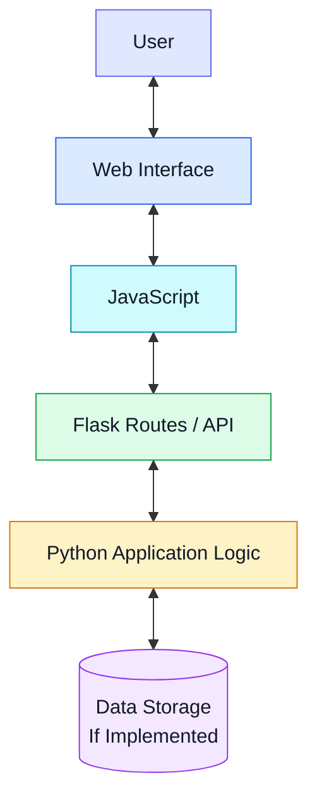

 <div align="center">

# Google Keep Clone

### A Minimalist Note-Taking Web Application

*A practical full-stack web development project built with Python, Flask, Tailwind CSS, and JavaScript.*

<br/>

[](https://www.python.org/)
[](https://flask.palletsprojects.com/)
[](https://tailwindcss.com/)
[](https://developer.mozilla.org/en-US/docs/Web/JavaScript)
[](https://github.com/maahii-in)

<br/>

[Overview](#overview) · [Technology](#technology-stack) · [Architecture](#architecture) · [Installation](#getting-started) · [Roadmap](#roadmap)

<br/>

</div>

---

## Overview

**Google Keep Clone** is a web application inspired by Google Keep, designed to explore the development of a simple and intuitive note-taking experience.

Built with Flask on the backend and a web interface using HTML, Tailwind CSS, and JavaScript, the project provides a foundation for learning full-stack development and understanding how frontend and backend components work together.

### Project Highlights

- Clean and straightforward user interface.
- Python-based backend using Flask.
- Modern styling with Tailwind CSS.
- Client-side interactivity using JavaScript.
- Practical experience with Git and GitHub.
- An extensible foundation for future improvements.

> The features described here should be aligned with the functionality implemented in the current version of the application.

## Technology Stack

<div align="center">

| Technology | Purpose |
|:--|:--|
| **Python** | Backend programming |
| **Flask** | Server-side application framework |
| **HTML5** | Webpage structure |
| **Tailwind CSS** | UI styling and layout |
| **JavaScript** | Frontend interactions |
| **Git & GitHub** | Version control and source code hosting |

</div>

## Project Preview

<div align="center">

<!-- Add a screenshot at assets/preview.png and uncomment the next line. -->

<!--  -->

*Application screenshot placeholder*

</div>

To showcase the project effectively, add a screenshot of the running application to an `assets` directory and display it above.

## Architecture

The application follows a conventional frontend-backend structure.



**Frontend:** Presents the interface and manages user interactions.

**Backend:** Uses Flask to process requests and execute application logic.

**Data storage:** Can be integrated to persist notes, depending on the implementation.

*The diagram illustrates the intended architecture and should be adjusted to match the actual application.*

## GitHub Analytics

<div align="center">

<a href="https://github.com/maahii-in">
  
</a>
<a href="https://github.com/maahii-in">
  
</a>

<br/><br/>


</div>

*These visualizations display GitHub account-level statistics and contribution activity, not exclusively metrics for this project. They depend on third-party services.*

## Repository Structure

```text
first-pratice-2021/
├── .vscode/
├── templates/
├── .gitignore
├── README.md
├── app_v2.py
├── app.py.txt
├── animi.txt
├── fasta3.txt
├── fasta4.txt
├── fastmain.txt
└── info.txt
```

*The structure reflects the repository information currently available. Update it as files are renamed or reorganized.*

## Getting Started

### Prerequisites

- Python 3
- pip
- Git

### 1. Clone the repository

```bash
git clone https://github.com/maahii-in/first-pratice-2021.git
```

### 2. Navigate to the project directory

```bash
cd first-pratice-2021
```

### 3. Create and activate a virtual environment

Create the environment:

```bash
python -m venv venv
```

Windows:

```bash
venv\Scripts\activate
```

macOS / Linux:

```bash
source venv/bin/activate
```

### 4. Install dependencies

If `requirements.txt` exists:

```bash
pip install -r requirements.txt
```

Otherwise, install the packages required by the application. For a basic Flask app:

```bash
pip install Flask
```

### 5. Run the application

If `app_v2.py` is the main application file:

```bash
python app_v2.py
```

### 6. Open in your browser

Visit the local address displayed in the terminal. The default Flask development address is commonly:

```text
http://127.0.0.1:5000
```

## Roadmap

The following improvements are potential future development goals.

- [ ] Complete note creation, editing, and deletion.
- [ ] Add search and filtering.
- [ ] Introduce labels, colors, and pinned notes.
- [ ] Integrate a database for persistent storage.
- [ ] Improve responsive design and accessibility.
- [ ] Add automated tests.
- [ ] Prepare a production deployment.

Mark features as completed only after they have been implemented and tested.

## Learning Outcomes

This project supports practical learning in:

- Python and Flask application development.
- Frontend structure and responsive styling.
- JavaScript-based interactivity.
- Frontend-backend communication.
- REST API fundamentals.
- Git-based development workflows.
- Technical documentation and repository management.

## Contributing

Suggestions and improvements are welcome.

1. Fork the repository.
2. Create a feature branch.
3. Implement and test your changes.
4. Commit with a descriptive message.
5. Submit a pull request.

## License

No license has been confirmed for this repository. Add a `LICENSE` file before specifying the terms under which others may use or distribute the project.

## Author

<div align="center">

### MAHI BUDATI

[](https://github.com/maahii-in)

*Building, learning, and improving through practical software projects.*

<br/>

**If you find this project interesting, consider giving the repository a star.**

</div>

