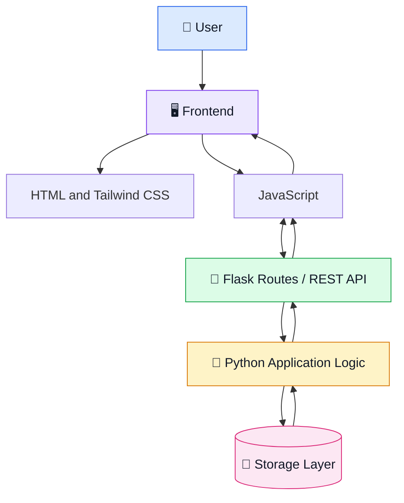
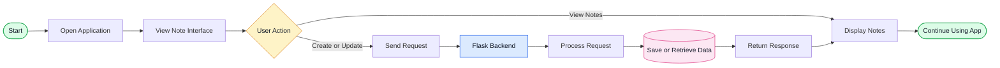

# ✨ Google Keep Clone

<div align="center">

  <h3>📝 A Simple, Modern & Lightweight Note-Taking Application</h3>

  <p>
    A Google Keep-inspired web application powered by Flask, Python, Tailwind CSS, and JavaScript.
  </p>

  <p>
    <a href="https://github.com/maahii-in/first-pratice-2021">
      
    </a>
    
    
    
  </p>

  <p>
    
    
    
  </p>

</div>

---

## 📌 About the Project

**Google Keep Clone** is a lightweight web application inspired by Google's note-taking experience. It is designed to provide a simple interface for managing notes while demonstrating the fundamentals of full-stack web development.

The project combines a Python Flask backend with a frontend built using HTML, Tailwind CSS, and vanilla JavaScript.

🎯 **Project Goals**

- Build a clean and intuitive web interface.
- Understand backend development using Flask.
- Explore frontend and backend communication.
- Practice REST API concepts.
- Improve Git and GitHub workflow skills.

## 🖼️ Project Preview

<div align="center">

  <!-- Add a screenshot of your application to assets/preview.png before enabling this image. -->
  <!--  -->

  <h3>📝 Organize Your Ideas. Capture Your Thoughts.</h3>

  A minimal note-taking experience built with modern web technologies.

</div>

> **Tip:** Add a screenshot of your running application to an `assets` folder and uncomment the image tag above to display an actual project preview.

---

## 🚀 Features

| Feature | Description |
|---|---|
| 🎨 Modern UI | Clean interface and consistent styling |
| 🐍 Flask Backend | Python-based server-side application |
| ⚡ JavaScript | Client-side interaction support |
| 📱 Responsive Design | Styling designed for different screen sizes |
| 🔌 API Integration | Foundation for frontend-backend communication |
| 🛠️ Easy to Extend | Structure suitable for future improvements |

*The feature list describes the intended project capabilities. Keep only the features that are implemented and tested in your current version.*

---

## 🧰 Technology Stack

<div align="center">

| Technology | Role | Badge |
|---|---|---|
| Python | Backend language |  |
| Flask | Web framework |  |
| HTML5 | Page structure |  |
| Tailwind CSS | UI styling |  |
| JavaScript | Frontend logic |  |
| Git | Version control |  |

</div>

---

## 📊 GitHub Project Statistics

<div align="center">

  <a href="https://github.com/maahii-in/first-pratice-2021">
    
  </a>

  

</div>

### 📈 Development Activity

<div align="center">

  

</div>

> **About these graphs:** They display repository information or GitHub account activity, depending on the card. The language and activity charts are account-level visualizations, not exclusively statistics for this project. These images depend on third-party services and may occasionally be unavailable.

---

## 🏗️ Application Architecture

The following diagram illustrates the intended high-level application architecture.



*This is a conceptual architecture. Adapt the storage layer and API flow to match your actual implementation.*

---

## 🔄 Application Workflow



*The diagram represents a proposed workflow. Remove or adjust steps that are not supported by the current application.*

---

## 📁 Project Structure

```text
first-pratice-2021/
│
├── .vscode/
│   └── Editor configuration
│
├── templates/
│   └── HTML templates
│
├── .gitignore
├── README.md
├── animi.txt
├── app.py.txt
├── app_v2.py
├── fasta3.txt
├── fasta4.txt
├── fastmain.txt
└── info.txt
```

This structure reflects the repository files visible in the current project screenshot. Update the tree as the application develops.

---

## ⚙️ Installation & Setup

### 1. Clone the repository

```bash
git clone https://github.com/maahii-in/first-pratice-2021.git
```

### 2. Open the project directory

```bash
cd first-pratice-2021
```

### 3. Create a virtual environment

```bash
python -m venv venv
```

### 4. Activate the environment

**Windows**

```bash
venv\Scripts\activate
```

**macOS / Linux**

```bash
source venv/bin/activate
```

### 5. Install the required dependencies

If your project contains a `requirements.txt` file:

```bash
pip install -r requirements.txt
```

Otherwise, install the packages required by your application. For a basic Flask backend:

```bash
pip install Flask
```

### 6. Start the application

If `app_v2.py` is your main Flask application file:

```bash
python app_v2.py
```

Otherwise, replace the filename with the correct entry point.

### 7. Open in your browser

```text
http://127.0.0.1:5000
```

The actual address may differ depending on your Flask configuration.

---

## 🎯 Development Roadmap

| Enhancement | Status |
|---|---|
| Flask application foundation | 🔧 Verify current implementation |
| Frontend and backend integration | 🔧 Verify current implementation |
| Create, edit, and delete notes | 📌 Planned |
| Search and filter functionality | 📌 Planned |
| Pin and categorize notes | 📌 Planned |
| Database persistence | 📌 Planned |
| User authentication | 📌 Planned |
| Automated testing and deployment | 📌 Planned |

**Roadmap legend**

- ✅ Completed — Implemented and tested
- 🔧 In progress — Currently being developed
- 📌 Planned — Considered for a future release

Update the status column as each feature is implemented.

---

## 🧠 What I Learned

Through this project, I am developing practical experience in:

- Building web applications with Python and Flask.
- Structuring web pages with HTML.
- Styling interfaces with Tailwind CSS.
- Working with frontend JavaScript.
- Understanding API-based communication.
- Using Git and GitHub for version control.
- Documenting and organizing software projects.

---

## 🔮 Future Improvements

- [ ] Add reliable database storage.
- [ ] Implement full note management functionality.
- [ ] Introduce search, labels, and pinning.
- [ ] Improve mobile accessibility and usability.
- [ ] Add user authentication and authorization.
- [ ] Write automated tests.
- [ ] Deploy the application to a hosting platform.

---

## 🤝 Contributing

Contributions and suggestions are welcome.

1. Fork the repository.
2. Create a feature branch.
3. Implement and test your changes.
4. Commit with a descriptive message.
5. Open a pull request.

---

## 📄 License

No license has been specified in the repository information currently available. Add a `LICENSE` file to define the permissions and terms for using, modifying, and distributing the project.

---

## 👨‍💻 Author

<div align="center">

  <h3>MAHI BUDATI</h3>

  <a href="https://github.com/maahii-in">
    
  </a>

  <p>
    Interested in web development, Python, and building practical software projects.
  </p>

</div>

---

<div align="center">

  ### ⭐ Thanks for Visiting!

  If you find this project interesting, consider starring the repository.

  **Built with 💙 using Python, Flask, and modern web technologies.**

  <a href="https://github.com/maahii-in/first-pratice-2021">
    
  </a>

</div>
