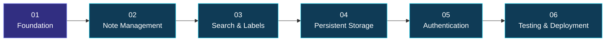

<div align="center">

<a id="top"></a>


<br/>


<br/><br/>

<a href="https://github.com/maahii-in/first-pratice-2021">

</a>
<a href="https://github.com/maahii-in/first-pratice-2021/stargazers">

</a>
<a href="https://github.com/maahii-in/first-pratice-2021/network/members">

</a>
<a href="https://github.com/maahii-in/first-pratice-2021/commits">

</a>

<br/><br/>


<br/><br/>

### A Minimalist Approach to Digital Note-Taking

*A web development project inspired by Google Keep, built with Python, Flask, and modern frontend technologies.*

</div>

---

<div align="center">

## ◈ PROJECT DASHBOARD

</div>

<table>
<tr>
<td align="center" width="25%">

**01 · PROJECT**

Google Keep Clone

</td>
<td align="center" width="25%">

**02 · BACKEND**

Python + Flask

</td>
<td align="center" width="25%">

**03 · FRONTEND**

HTML + Tailwind CSS

</td>
<td align="center" width="25%">

**04 · PURPOSE**

Full-Stack Learning

</td>
</tr>
</table>

<div align="center">

### Quick Navigation

<a href="#-01--about-the-project">ABOUT</a> &nbsp; ◆ &nbsp;
<a href="#-02--feature-showcase">FEATURES</a> &nbsp; ◆ &nbsp;
<a href="#-03--technology-stack">TECH STACK</a> &nbsp; ◆ &nbsp;
<a href="#-04--product-showcase">SHOWCASE</a> &nbsp; ◆ &nbsp;
<a href="#-05--github-analytics">GRAPHS</a> &nbsp; ◆ &nbsp;
<a href="#-06--system-design">ARCHITECTURE</a> &nbsp; ◆ &nbsp;
<a href="#-08--installation">SETUP</a> &nbsp; ◆ &nbsp;
<a href="#-10--developer-profile">DEVELOPER</a>

</div>

---

<div align="center">


### Ideas deserve a beautiful place.

</div>

**Google Keep Clone** is a lightweight web application inspired by the simplicity of Google Keep. It combines a Python and Flask backend with a frontend built using HTML, Tailwind CSS, and JavaScript.

The project explores full-stack web development, including interface design, server-side logic, frontend-backend communication, and source code management with Git and GitHub.

<div align="center">

<table>
<tr>
<td width="50%" valign="top">

### 🎯 The Vision

Create a simple note-taking experience with a clean interface and an understandable application structure.

</td>
<td width="50%" valign="top">

### 💡 The Approach

Use established web technologies to understand the lifecycle of a browser-based application.

</td>
</tr>
<tr>
<td width="50%" valign="top">

### 🧠 The Learning

Explore Flask routing, Python logic, frontend styling, JavaScript, and software documentation.

</td>
<td width="50%" valign="top">

### 🚀 The Opportunity

Build a foundation for future work in persistence, search, authentication, testing, and deployment.

</td>
</tr>
</table>

</div>

> **Design principle:** Keep the experience simple, the code understandable, and the architecture flexible enough to improve over time.

---

<div align="center">


### Built around simplicity. Designed for growth.

</div>

<table>
<tr>
<td width="50%" valign="top">

<div align="center">


### 🎨 Interface Design

</div>

Create a clean visual foundation using familiar web technologies.

- HTML page structure
- Tailwind CSS styling
- Consistent visual hierarchy
- Responsive layout as a design goal

</td>
<td width="50%" valign="top">

<div align="center">


### ⚙️ Backend Engineering

</div>

Explore a Python-based backend using Flask.

- Application routes
- HTTP request handling
- Python application logic
- API integration where implemented

</td>
</tr>
<tr>
<td width="50%" valign="top">

<div align="center">


### ⚡ Client-Side Interaction

</div>

Use JavaScript to explore browser-side behavior.

- Event handling
- Frontend interactions
- Communication with backend endpoints
- Dynamic updates where implemented

</td>
<td width="50%" valign="top">

<div align="center">


### 🚀 Future Potential

</div>

Potential improvements for a more complete application.

- Search and filtering
- Note editing and deletion
- Persistent storage
- User accounts and personalization

</td>
</tr>
</table>

<details>
<summary><strong>✦ Explore potential enhancements</strong></summary>

| Capability | Potential benefit |
|---|---|
| Note management | Create, edit, delete, pin, and archive notes |
| Search | Find information efficiently |
| Labels | Organize related notes |
| Colors | Visually distinguish notes |
| Database integration | Preserve data between sessions |
| Authentication | Support individual user accounts |

These are possible improvements, not claims that all features already exist in the application.

</details>

---

<div align="center">


### The tools powering the project

<br/>

<a href="https://www.python.org/"></a>
&nbsp;&nbsp;&nbsp;
<a href="https://flask.palletsprojects.com/"></a>
&nbsp;&nbsp;&nbsp;
<a href="https://developer.mozilla.org/en-US/docs/Web/HTML"></a>
&nbsp;&nbsp;&nbsp;
<a href="https://tailwindcss.com/"></a>
&nbsp;&nbsp;&nbsp;
<a href="https://developer.mozilla.org/en-US/docs/Web/JavaScript"></a>
&nbsp;&nbsp;&nbsp;
<a href="https://git-scm.com/"></a>

</div>

| Technology | Responsibility | Documentation |
|---|---|---|
| Python | Backend programming | [Python Docs](https://docs.python.org/3/) |
| Flask | Web framework and routing | [Flask Docs](https://flask.palletsprojects.com/) |
| HTML5 | Page structure | [HTML Docs](https://developer.mozilla.org/en-US/docs/Web/HTML) |
| Tailwind CSS | Styling and layout | [Tailwind Docs](https://tailwindcss.com/docs) |
| JavaScript | Client-side interactions | [JavaScript Docs](https://developer.mozilla.org/en-US/docs/Web/JavaScript) |
| Git | Version control | [Git Docs](https://git-scm.com/doc) |
| GitHub | Repository hosting | [GitHub Docs](https://docs.github.com/) |

<div align="center">

`PRESENTATION` &nbsp; → &nbsp; `APPLICATION LOGIC` &nbsp; → &nbsp; `RESPONSE`

</div>

---

<div align="center">


### Show the real application, not just the code.

</div>

<div align="center">

<!-- Upload your actual screenshot to assets/preview.png and uncomment the image below. -->

<!--  -->


<sub>Replace this placeholder with a screenshot of your running application.</sub>

</div>

<div align="center">

| 🖥️ Desktop | ✍️ Interaction | 📱 Mobile |
|---|---|---|
| Main application interface | An implemented user workflow | Responsive application view |

</div>

<details>
<summary><strong>📸 How to add your screenshot</strong></summary>

1. Create an `assets` folder in your repository.
2. Upload your screenshot as `assets/preview.png`.
3. Replace the placeholder with:

```html

```

Use genuine screenshots of the actual application.

</details>

---

<div align="center">


### Developer activity at a glance

</div>

<div align="center">

<a href="https://github.com/maahii-in"></a><a href="https://github.com/maahii-in"></a>

<br/><br/>

### Contribution Streak


<br/><br/>

### Contribution Activity


<br/><br/>

### Achievement Gallery


<br/><br/>

<a href="https://github.com/maahii-in?tab=repositories"></a>

</div>

<details>
<summary><strong>📊 About these graphs</strong></summary>

The statistics are generated by third-party services using available GitHub account information.

- Account statistics summarize available profile activity.
- Language charts cover detected languages across the account's repositories.
- Streak and activity graphs visualize qualifying contribution activity.
- Trophy cards display achievements calculated by the provider.

These are account-level visualizations, not project performance measurements. They depend on external services and public account information.

</details>

---

<div align="center">


### A visual model of the application

</div>


### Request lifecycle


*These diagrams describe a conventional architecture. Update them to match the actual implementation.*

---

<div align="center">


### Keep the codebase organized

</div>

```text
first-pratice-2021/
│
├── .vscode/           # Editor configuration
├── templates/         # HTML templates
├── .gitignore         # Git ignore configuration
├── README.md          # Project documentation
├── app_v2.py          # Potential application entry point
├── app.py.txt         # Verify filename and contents
├── animi.txt          # Supporting file
├── fasta3.txt         # Supporting file
├── fasta4.txt         # Supporting file
├── fastmain.txt       # Supporting file
└── info.txt           # Project information
```

This structure reflects the files visible in your repository screenshot. Verify the role of each file before finalizing its description.

---

<div align="center">


### From source code to a running application

</div>

### Requirements

- Python 3
- pip
- Git
- A modern web browser

### 01 — Clone the repository

```bash
git clone https://github.com/maahii-in/first-pratice-2021.git
cd first-pratice-2021
```

### 02 — Create a virtual environment

```bash
python -m venv venv
```

### 03 — Activate the environment

**Windows**

```powershell
venv\Scripts\activate
```

**macOS / Linux**

```bash
source venv/bin/activate
```

### 04 — Install dependencies

If `requirements.txt` exists:

```bash
pip install -r requirements.txt
```

Otherwise, install the dependencies used by your application. For a basic Flask application:

```bash
pip install Flask
```

### 05 — Run the application

If `app_v2.py` is the correct entry point:

```bash
python app_v2.py
```

Change the filename if the application starts elsewhere.

### 06 — Open the application

Visit the local address printed in the terminal, commonly:

```text
http://127.0.0.1:5000
```

<details>
<summary><strong>⚠️ Troubleshooting</strong></summary>

| Problem | Suggested action |
|---|---|
| Python is not recognized | Verify Python installation and PATH |
| Missing module | Activate the virtual environment and install the dependency |
| Application fails to start | Inspect the traceback and confirm the entry point |
| Page returns 404 | Check the Flask routes |
| Port already in use | Check the process occupying the port |

</details>

> Flask's development server is intended for local development and testing. Use an appropriate production server when deploying publicly.

---

<div align="center">


### A foundation for continuous improvement

</div>



| Milestone | Objective | Status |
|---|---|---|
| 01 | Review and document the application | Review |
| 02 | Complete note management | Planned |
| 03 | Add search and organization | Planned |
| 04 | Integrate persistent storage | Planned |
| 05 | Add authentication and access controls | Planned |
| 06 | Introduce automated testing | Planned |
| 07 | Prepare production deployment | Planned |

These milestones are proposed improvements. Update each status as work is completed and tested.

---

<div align="center">


<br/><br/>

# MAHI BUDATI

### Aspiring Developer · Python · Flask · Web Development

Building practical applications, exploring modern web technologies, and improving through hands-on software development.

<br/>

<a href="https://github.com/maahii-in">

</a>
<a href="https://github.com/maahii-in/first-pratice-2021">

</a>

<br/><br/>

### Built with curiosity. Improved through practice.

*Learn continuously. Build thoughtfully. Improve consistently.*

<br/><br/>

<a href="https://github.com/maahii-in/first-pratice-2021/stargazers">

</a>

<br/><br/>

<a href="#top">

</a>


</div>

---

<div align="center">

<sub>Designed with purpose · Built through practice · Documented for the community</sub>

</div>

<!-- END OF README -->

