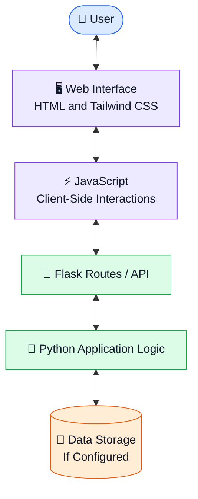
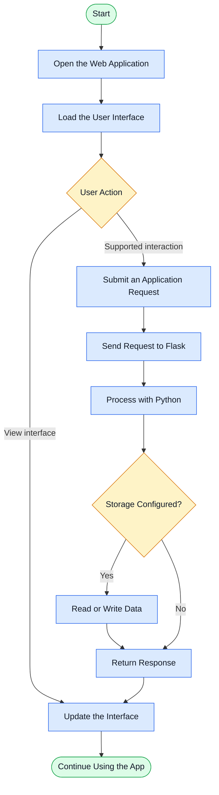

<!-- ========================================================= -->
<!--                GOOGLE KEEP CLONE README                 -->
<!-- ========================================================= -->

<div align="center">

  

  <br>

  

  <br><br>

  <p>
    <a href="https://github.com/maahii-in/first-pratice-2021">
      
    </a>
    <a href="https://github.com/maahii-in/first-pratice-2021/stargazers">
      
    </a>
    <a href="https://github.com/maahii-in/first-pratice-2021/network/members">
      
    </a>
  </p>

  <p>
    
    
    
    
    
    
  </p>

  <br>

  **A clean, lightweight note-taking application inspired by Google Keep.**

  *Designed to explore full-stack development, modern user interfaces, backend logic, and the GitHub workflow.*

  <br>

  <a href="#-about-the-project">About</a> •
  <a href="#-features">Features</a> •
  <a href="#-technology-stack">Tech Stack</a> •
  <a href="#-github-analytics">Analytics</a> •
  <a href="#-installation-guide">Installation</a> •
  <a href="#-roadmap">Roadmap</a>

</div>

---

## 📑 Table of Contents

- [About the Project](#-about-the-project)
- [Why This Project?](#-why-this-project)
- [Features](#-features)
- [Technology Stack](#-technology-stack)
- [Project Screenshots](#-project-screenshots)
- [Project Architecture](#-project-architecture)
- [Application Workflow](#-application-workflow)
- [GitHub Analytics](#-github-analytics)
- [Repository Structure](#-repository-structure)
- [Installation Guide](#-installation-guide)
- [Configuration](#-configuration)
- [Development Workflow](#-development-workflow)
- [Roadmap](#-roadmap)
- [Challenges and Learnings](#-challenges-and-learnings)
- [Contributing](#-contributing)
- [License](#-license)
- [About the Developer](#-about-the-developer)

---

## 🌟 About the Project

**Google Keep Clone** is a lightweight web application inspired by the simplicity and usability of Google Keep.

The project combines a **Python and Flask backend** with a web frontend built using **HTML, Tailwind CSS, and JavaScript**. It serves as a practical project for learning how different components of a web application work together.

Rather than focusing only on writing code, the project also explores application structure, frontend-backend communication, project documentation, and source code management with Git and GitHub.

<div align="center">

| 📝 Note-taking | 🎨 Interface Design | ⚙️ Backend Development | 🔧 Developer Workflow |
|:---:|:---:|:---:|:---:|
| Organize ideas | Style web pages | Work with Flask | Practice Git |

</div>

### 🎯 Project Vision

To create a straightforward, accessible, and maintainable note-taking experience while strengthening practical full-stack web development skills.

### 💡 The Problem

Ideas, reminders, and short pieces of information are often scattered across different applications and documents. A dedicated note-taking interface can make capturing and reviewing information more convenient.

### ✅ The Approach

This project uses familiar web technologies to explore the building blocks of a note-taking application, with a focus on clarity, simplicity, and extensibility.

---

## 💎 Why This Project?

<div align="center">

<table>
<tr>
<td width="50%" valign="top">

### 🐍 Python-Powered

Explore server-side programming, request handling, and application logic using Python.

</td>
<td width="50%" valign="top">

### 🌐 Web-Based Interface

Build a user-facing application using HTML, CSS utilities, and JavaScript.

</td>
</tr>
<tr>
<td width="50%" valign="top">

### 🔌 Backend Integration

Understand how frontend interactions can communicate with Flask routes and APIs.

</td>
<td width="50%" valign="top">

### 📈 Continuous Learning

Practice readable code, project documentation, version control, and incremental improvements.

</td>
</tr>
</table>

</div>

---

## 🚀 Features

The following sections describe the project's intended capabilities. Keep a feature marked as implemented only after confirming it works in your current application.

<table>
<tr>
<td width="50%" valign="top">

### 📝 Note Management

- Create and display notes.
- Edit existing notes.
- Delete unwanted notes.
- Keep information organized.

</td>
<td width="50%" valign="top">

### 🎨 User Interface

- Clean, simple visual layout.
- Tailwind CSS utility-based styling.
- Clear content hierarchy.
- Potential support for responsive screens.

</td>
</tr>
<tr>
<td width="50%" valign="top">

### ⚙️ Backend

- Python application logic.
- Flask routing.
- Request and response handling.
- API integration where implemented.

</td>
<td width="50%" valign="top">

### 🔮 Extensibility

- Database integration.
- Search and filtering.
- Note labels and colors.
- User accounts and personalization.

</td>
</tr>
</table>

---

## 🧰 Technology Stack

<div align="center">

  <h3>Technologies Behind the Application</h3>

  <a href="https://www.python.org/">
    
  </a>
  &nbsp;&nbsp;
  <a href="https://flask.palletsprojects.com/">
    
  </a>
  &nbsp;&nbsp;
  <a href="https://developer.mozilla.org/en-US/docs/Web/HTML">
    
  </a>
  &nbsp;&nbsp;
  <a href="https://tailwindcss.com/">
    
  </a>
  &nbsp;&nbsp;
  <a href="https://developer.mozilla.org/en-US/docs/Web/JavaScript">
    
  </a>
  &nbsp;&nbsp;
  <a href="https://git-scm.com/">
    
  </a>

</div>

| Technology | Responsibility |
|---|---|
| Python | Core backend programming |
| Flask | Server-side application framework |
| HTML5 | Webpage structure and content |
| Tailwind CSS | Visual styling and layout |
| JavaScript | Client-side behavior and interactions |
| Git | Source code version control |
| GitHub | Code hosting and collaboration |

---

## 🖼️ Project Screenshots

<div align="center">

### Application Preview

<!--
HOW TO ADD YOUR SCREENSHOT:

1. Create a folder named assets in your repository.
2. Upload your actual application screenshot as assets/homepage.png.
3. Uncomment the image tag below.
-->

<!--  -->

**Add your actual application screenshot here.**

A screenshot of the running application will make this repository more informative and visually appealing to visitors.

</div>

### 📸 Recommended Screenshots

| Screenshot | What to Show |
|---|---|
| Home screen | Main note-taking interface |
| Note creation | Creating a new note |
| Note management | Viewing, editing, or deleting notes |
| Mobile layout | Interface on a smaller screen |

*Only include screenshots of functionality that exists in the application.*

---

## 🏗️ Project Architecture

The diagram below illustrates a conceptual frontend-backend architecture for this type of application.



### Architecture Overview

**1. Presentation Layer**

HTML provides the structure, Tailwind CSS handles styling, and JavaScript supports client-side interactions.

**2. Application Layer**

Flask provides the server-side framework for handling requests and connecting application routes to Python logic.

**3. Data Layer**

A storage mechanism can be connected to save notes persistently. Its specific implementation should match the actual project.

---

## 🔄 Application Workflow



*This is a conceptual workflow, not a claim that every step is already implemented.*

---

## 📊 GitHub Analytics

<div align="center">

  <h3>📈 Repository Overview</h3>

  <a href="https://github.com/maahii-in/first-pratice-2021">
    
  </a>

  <a href="https://github.com/maahii-in">
    
  </a>

  <br><br>

  <h3>💻 Programming Languages</h3>

  

  <br><br>

  <h3>🔥 Contribution Streak</h3>

  

  <br><br>

  <h3>📉 Contribution Activity Graph</h3>

  

  <br><br>

  <h3>🏆 GitHub Achievements</h3>

  

</div>

### 📌 Understanding These Graphs

- **Repository card:** Highlights this project's public repository.
- **GitHub statistics:** Summarizes available account-level activity.
- **Language chart:** Displays detected languages across repositories, not just this application.
- **Contribution streak:** Visualizes qualifying GitHub contribution activity.
- **Activity graph:** Plots contribution history.
- **Trophy panel:** Displays achievements calculated by the third-party service.

These are dynamic, account-level displays where indicated, rather than verified project quality metrics. Their appearance depends on public data, service availability, and provider configuration.

---

## 📂 Repository Structure

```text
first-pratice-2021/
│
├── .vscode/
│   └── Editor configuration
│
├── templates/
│   └── HTML templates
│
├── .gitignore
├── README.md
├── animi.txt
├── app.py.txt
├── app_v2.py
├── fasta3.txt
├── fasta4.txt
├── fastmain.txt
└── info.txt
```

This structure is based on the files visible in the current repository. Update the tree whenever files are renamed, added, or removed.

**Recommended cleanup:** If `app.py.txt` is intended to be an executable Python file, rename it to `app.py`. Keep the actual application entry point clearly identified and document supporting files where necessary.

---

## ⚡ Installation Guide

### Prerequisites

Before starting, install:

- Python 3
- pip
- Git
- A modern web browser

### Step 1 — Clone the Repository

```bash
git clone https://github.com/maahii-in/first-pratice-2021.git
```

### Step 2 — Navigate to the Directory

```bash
cd first-pratice-2021
```

### Step 3 — Create a Virtual Environment

```bash
python -m venv venv
```

### Step 4 — Activate the Environment

**Windows**

```bash
venv\Scripts\activate
```

**macOS / Linux**

```bash
source venv/bin/activate
```

### Step 5 — Install Dependencies

If your repository contains `requirements.txt`:

```bash
pip install -r requirements.txt
```

Otherwise, install the dependencies actually used by your application. For a basic Flask application:

```bash
pip install Flask
```

If other Python packages are imported in the source code, install those as well.

### Step 6 — Run the Application

If `app_v2.py` contains the main Flask application:

```bash
python app_v2.py
```

Use the correct filename if your application starts from another file.

### Step 7 — Access the Application

Open the local URL shown in your terminal. A default Flask development server commonly uses:

```text
http://127.0.0
