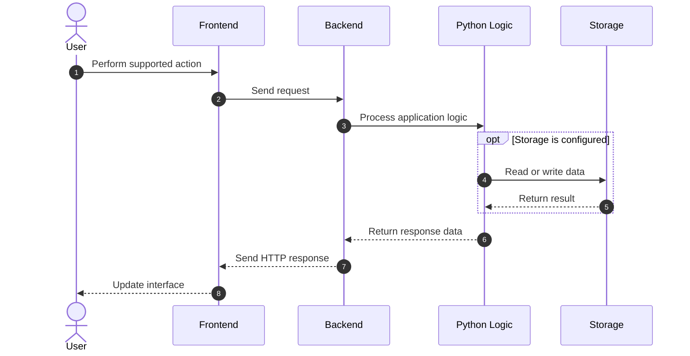
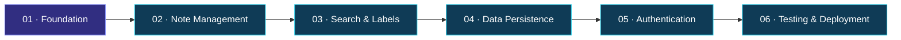

<div align="center">

<a id="top"></a>


<br/>


<br/><br/>

<a href="https://github.com/maahii-in/first-pratice-2021">

</a>
<a href="https://github.com/maahii-in/first-pratice-2021/stargazers">

</a>
<a href="https://github.com/maahii-in/first-pratice-2021/network/members">

</a>

<br/><br/>


<br/><br/>

**A lightweight note-taking web application inspired by Google Keep.**

*Minimal concept. Modern web technologies. Endless opportunities to improve.*

</div>

---

<div align="center">

## ◈ YOUR PROJECT AT A GLANCE

</div>

<table>
<tr>
<td width="50%" valign="top">

#### 🎯 PROJECT

**Google Keep Clone**

A web development project exploring the foundations of digital note-taking and full-stack application development.

</td>
<td width="50%" valign="top">

#### 🛠️ BUILT WITH

**Python + Flask**

Combined with HTML, Tailwind CSS, and JavaScript for frontend and backend development.

</td>
</tr>
<tr>
<td width="50%" valign="top">

#### 🎨 DESIGN DIRECTION

**Simple & Intuitive**

A design philosophy focused on readability, clarity, and ease of use.

</td>
<td width="50%" valign="top">

#### 🚀 DEVELOPMENT GOAL

**Learn by Building**

Explore application architecture, interface design, request handling, and version control.

</td>
</tr>
</table>

---

<div align="center">

### ✦ NAVIGATION ✦

</div>

| Section | Explore |
|:---|:---|
| `01` | [Project Overview](#-01--the-project) |
| `02` | [Visual Features](#-02--feature-showcase) |
| `03` | [Technology Stack](#-03--technology-ecosystem) |
| `04` | [Application Preview](#-04--the-product) |
| `05` | [GitHub Analytics](#-05--developer-analytics) |
| `06` | [System Architecture](#-06--system-architecture) |
| `07` | [Setup Guide](#-07--getting-started) |
| `08` | [Development Roadmap](#-08--roadmap) |
| `09` | [Developer Profile](#-09--the-developer) |

---

<div align="center">


# ◈ 01 / THE PROJECT

### A simple idea, built with modern web technologies

</div>

**Google Keep Clone** is a web application inspired by the simplicity of Google Keep. It combines a Python and Flask backend with a frontend created using HTML, Tailwind CSS, and JavaScript.

The project serves as a practical foundation for learning full-stack development, exploring frontend-backend communication, and understanding the structure of a web application.

<div align="center">

<table>
<tr>
<td align="center" width="25%">

### 01

**Capture**

<br/>

Explore the foundations of digital note-taking.

</td>
<td align="center" width="25%">

### 02

**Design**

<br/>

Create clean and understandable interfaces.

</td>
<td align="center" width="25%">

### 03

**Connect**

<br/>

Understand communication between application layers.

</td>
<td align="center" width="25%">

### 04

**Evolve**

<br/>

Build on the project with future improvements.

</td>
</tr>
</table>

</div>

### The philosophy

> Technology becomes powerful when it transforms complicated tasks into simple experiences.

The project emphasizes readable code, a clear interface, practical experimentation, and a foundation that can be expanded over time.

---

<div align="center">


# ◈ 02 / FEATURE SHOWCASE

### The building blocks of the application

</div>

<table>
<tr>
<td width="50%" valign="top">

### 🎨 Interface Design

Create a clean visual foundation using standard web technologies.

- HTML page structure
- Tailwind CSS styling
- Consistent visual hierarchy
- Responsive layout as a design goal

</td>
<td width="50%" valign="top">

### 🐍 Backend Development

Explore Python application logic with Flask.

- Server-side request handling
- Application routes
- Backend processing
- API integration where implemented

</td>
</tr>
<tr>
<td width="50%" valign="top">

### ⚡ Frontend Interactivity

Use JavaScript to support browser-side behavior.

- Event handling
- Client-side interactions
- Communication with backend endpoints
- Dynamic updates where implemented

</td>
<td width="50%" valign="top">

### 🔮 Future Possibilities

Potential extensions for a more complete note-taking application.

- Create, edit, and delete notes
- Search and organization
- Persistent storage
- User accounts and personalization

</td>
</tr>
</table>

<details>
<summary><strong>Explore potential feature improvements</strong></summary>

| Feature | Purpose |
|:---|:---|
| Search | Find notes by title or content |
| Labels | Organize related information |
| Pinning | Keep important notes accessible |
| Colors | Visually distinguish different notes |
| Database | Preserve information across sessions |
| Authentication | Protect personalized user content |

These are possible enhancements. Keep only features that are implemented and verified in the current application when describing the product as complete.

</details>

---

<div align="center">


# ◈ 03 / TECHNOLOGY ECOSYSTEM

### The tools behind the experience

<br/>

<a href="https://www.python.org/">

</a>
&nbsp;&nbsp;&nbsp;
<a href="https://flask.palletsprojects.com/">

</a>
&nbsp;&nbsp;&nbsp;
<a href="https://developer.mozilla.org/en-US/docs/Web/HTML">

</a>
&nbsp;&nbsp;&nbsp;
<a href="https://tailwindcss.com/">

</a>
&nbsp;&nbsp;&nbsp;
<a href="https://developer.mozilla.org/en-US/docs/Web/JavaScript">

</a>
&nbsp;&nbsp;&nbsp;
<a href="https://git-scm.com/">

</a>

</div>

| Technology | Function | Official Resource |
|:---|:---|:---|
| Python | Backend programming | [Explore](https://docs.python.org/3/) |
| Flask | Web application framework | [Explore](https://flask.palletsprojects.com/) |
| HTML5 | Document structure | [Explore](https://developer.mozilla.org/en-US/docs/Web/HTML) |
| Tailwind CSS | UI styling | [Explore](https://tailwindcss.com/docs) |
| JavaScript | Frontend interactions | [Explore](https://developer.mozilla.org/en-US/docs/Web/JavaScript) |
| Git | Version control | [Explore](https://git-scm.com/doc) |
| GitHub | Repository hosting | [Explore](https://docs.github.com/) |

<div align="center">

`Frontend` &nbsp; → &nbsp; `Flask Routes` &nbsp; → &nbsp; `Python Logic`

</div>

---

<div align="center">


# ◈ 04 / THE PRODUCT

### Show the real application, not just the code

</div>

<div align="center">

<!-- Upload your actual screenshot to assets/preview.png and uncomment this image. -->

<!--  -->


<sub>Replace the placeholder with a screenshot of your actual application.</sub>

</div>

<div align="center">

<table>
<tr>
<td align="center" width="33%">

**01 · Homepage**

<br/>

Present the application's real interface.

</td>
<td align="center" width="33%">

**02 · User Interaction**

<br/>

Show an implemented note management workflow.

</td>
<td align="center" width="33%">

**03 · Responsive View**

<br/>

Show the application on a smaller screen.

</td>
</tr>
</table>

</div>

### Add your own screenshot

Create an `assets` directory, upload your screenshot as `preview.png`, and replace the placeholder with:

```html

```

A genuine screenshot will make the repository feel much more like a finished product.

---

<div align="center">


# ◈ 05 / DEVELOPER ANALYTICS

### A visual overview of your GitHub activity

</div>

<div align="center">

<a href="https://github.com/maahii-in">

</a>
<a href="https://github.com/maahii-in">

</a>

<br/><br/>

### Contribution Streak


<br/><br/>

### Activity Graph


<br/><br/>

### Profile Achievements


</div>

<details>
<summary><strong>About the graphs and statistics</strong></summary>

These visualizations are generated dynamically by third-party services.

- Account statistics summarize available GitHub activity.
- The language chart covers repositories across the account, not just this project.
- The streak and activity graph visualize qualifying contribution activity.
- Achievement cards display trophies calculated by the provider.

These are account-level visualizations rather than project performance metrics. Their availability depends on the external services and the information they can access.

</details>

---

<div align="center">


# ◈ 06 / SYSTEM ARCHITECTURE

### A visual model of frontend and backend communication

</div>


### Request lifecycle



*These diagrams illustrate a proposed application architecture. Adjust them to reflect the actual source code and implemented data flow.*

---

<div align="center">


# ◈ 07 / GETTING STARTED

### Set up your development environment

</div>

#### Prerequisites

- Python 3
- pip
- Git
- A modern web browser

#### 01 — Clone the repository

```bash
git clone https://github.com/maahii-in/first-pratice-2021.git
cd first-pratice-2021
```

#### 02 — Create a virtual environment

```bash
python -m venv venv
```

#### 03 — Activate the environment

**Windows**

```powershell
venv\Scripts\activate
```

**macOS / Linux**

```bash
source venv/bin/activate
```

#### 04 — Install dependencies

If the repository contains a `requirements.txt` file:

```bash
pip install -r requirements.txt
```

Otherwise, install the actual dependencies required by the application. For a basic Flask application:

```bash
pip install Flask
```

#### 05 — Launch the application

If `app_v2.py` is the main application file:

```bash
python app_v2.py
```

Replace the filename if the actual entry point differs.

#### 06 — Open in your browser

Visit the local address printed in your terminal, commonly:

```text
http://127.0.0.1:5000
```

<details>
<summary><strong>Troubleshooting guide</strong></summary>

| Problem | What to check |
|---|---|
| Python command fails | Confirm Python is installed and available on PATH |
| Missing module | Activate the virtual environment and install the dependency |
| Application fails to start | Inspect the terminal error and verify the entry-point filename |
| Page returns 404 | Confirm that the requested Flask route exists |
| Port is unavailable | Check whether another process is using the configured port |

</details>

> Use Flask's development server for local testing. A public deployment should use an appropriate production server and configuration.

---

<div align="center">


# ◈ 08 / ROADMAP

### Where the project can go next

</div>



| Milestone | Goal | Status |
|---|---|---|
| 01 | Review and document existing application | Review |
| 02 | Implement complete note management | Planned |
| 03 | Introduce search and categorization | Planned |
| 04 | Integrate persistent database storage | Planned |
| 05 | Add authentication and access controls | Planned |
| 06 | Write automated tests | Planned |
| 07 | Prepare deployment configuration | Planned |

*Update the statuses as work is completed. Planned features should not be presented as implemented.*

---

<div align="center">


# ◈ 09 / DEVELOPER PROFILE


<br/><br/>

<a href="https://github.com/maahii-in">

</a>

## MAHI BUDATI

**Aspiring Developer · Python · Flask · Web Development**

Exploring modern web technologies, building practical applications, and continuously improving through hands-on development.

<br/>

<a href="https://github.com/maahii-in">

</a>
<a href="https://github.com/maahii-in/first-pratice-2021">

</a>

<br/><br/>

### Every project is a step forward.

*Learn continuously. Build thoughtfully. Improve consistently.*

<br/>

<a href="https://github.com/maahii-in/first-pratice-2021/stargazers">

</a>

<br/><br/>

<a href="#top">

</a>


</div>

---

<div align="center">

<sub>Designed with purpose · Developed with curiosity · Documented for the community</sub>

</div>

<!-- END OF README -->

