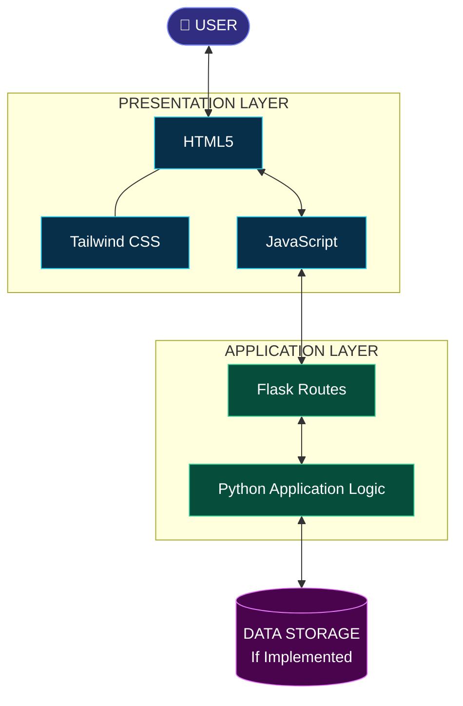
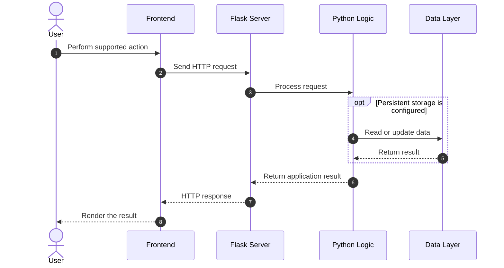
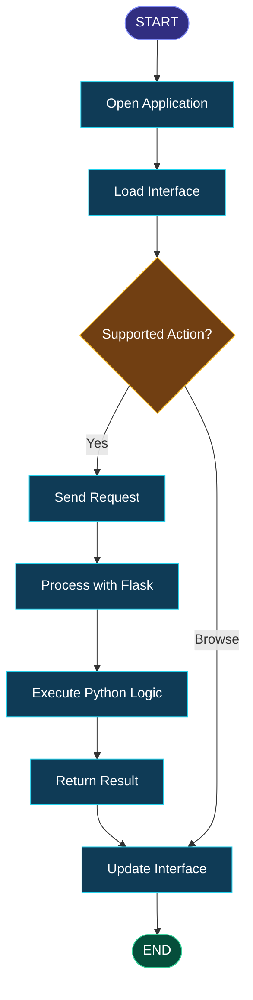
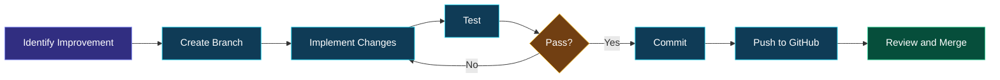
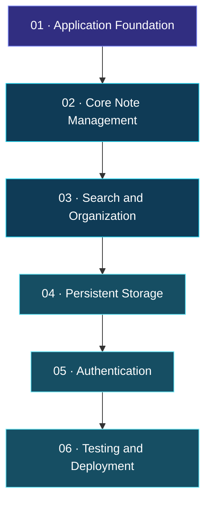

<div align="center">

<a id="top"></a>


<br/><br/>

<a href="https://github.com/maahii-in/first-pratice-2021">

</a>
<a href="https://github.com/maahii-in/first-pratice-2021/stargazers">

</a>
<a href="https://github.com/maahii-in/first-pratice-2021/network/members">

</a>

<br/><br/>


<br/><br/>

**A modern, lightweight note-taking application inspired by Google Keep.**

*Simple by design. Powerful in possibility. Built to learn, create, and evolve.*

<br/>

</div>

---

<div align="center">

## ◈ EXPLORE THE EXPERIENCE

<a href="#-01--project-overview">OVERVIEW</a> &nbsp; ✦ &nbsp;
<a href="#-02--feature-showcase">FEATURES</a> &nbsp; ✦ &nbsp;
<a href="#-03--technology-ecosystem">TECH STACK</a> &nbsp; ✦ &nbsp;
<a href="#-06--github-analytics">ANALYTICS</a>

<a href="#-07--system-architecture">ARCHITECTURE</a> &nbsp; ✦ &nbsp;
<a href="#-09--getting-started">GET STARTED</a> &nbsp; ✦ &nbsp;
<a href="#-12--development-roadmap">ROADMAP</a> &nbsp; ✦ &nbsp;
<a href="#-15--developer-profile">DEVELOPER</a>

</div>

---

# ◈ 01 — PROJECT OVERVIEW

<div align="center">

### Your thoughts. Your workspace. Your creativity.

</div>

**Google Keep Clone** is a web application inspired by the simplicity and convenience of digital note-taking. It combines a Python and Flask backend with a frontend built using HTML, Tailwind CSS, and JavaScript.

The project serves as a practical foundation for exploring full-stack web development, creating user interfaces, processing backend requests, and managing source code with Git and GitHub.

<div align="center">

<table>
<tr>
<td align="center" width="25%">

### 📝

**Capture**

<br/>

Explore the foundations of digital note-taking.

</td>
<td align="center" width="25%">

### 🎨

**Design**

<br/>

Build an intuitive web interface.

</td>
<td align="center" width="25%">

### ⚙️

**Develop**

<br/>

Connect the frontend to backend logic.

</td>
<td align="center" width="25%">

### 🚀

**Evolve**

<br/>

Expand the application over time.

</td>
</tr>
</table>

</div>

## ✧ The vision

A useful note-taking application should be easy to understand, simple to navigate, and flexible enough to grow with its users.

This project explores those principles while building a practical understanding of modern web technologies.

### The development philosophy

- **Clarity over complexity** — keep the interface and code understandable.
- **Modularity over duplication** — organize application responsibilities clearly.
- **Practical learning over theory alone** — turn concepts into working software.
- **Continuous improvement** — develop, test, document, and refine.

---

# ◈ 02 — FEATURE SHOWCASE

<div align="center">

### A foundation for a smarter note-taking experience

</div>

<table>
<tr>
<td width="50%" valign="top">

### 🎨 Interface Design

A visual foundation focused on simplicity, readability, and consistent presentation.

- HTML-based page structure
- Tailwind CSS styling
- Clear visual hierarchy
- Responsive layouts as a design goal

</td>
<td width="50%" valign="top">

### 🐍 Backend Engineering

A Python-based backend using Flask.

- Server-side application logic
- Request routing
- HTTP request and response handling
- API integration where implemented

</td>
</tr>
<tr>
<td width="50%" valign="top">

### ⚡ Frontend Interactivity

JavaScript provides the foundation for browser-based interactions.

- Event handling
- Frontend behavior
- Communication with backend endpoints
- Interface updates where implemented

</td>
<td width="50%" valign="top">

### 🔮 Extensible Architecture

Potential areas for future development include:

- Note editing and deletion
- Search and organization
- Database persistence
- User accounts and personalization

</td>
</tr>
</table>

> **Implementation accuracy:** These cards describe the technical focus and potential of the project. Mark functionality as implemented only after verifying it in the source code.

---

# ◈ 03 — TECHNOLOGY ECOSYSTEM

<div align="center">

### The technologies behind the project

<br/>

<a href="https://www.python.org/">

</a>
&nbsp;&nbsp;&nbsp;
<a href="https://flask.palletsprojects.com/">

</a>
&nbsp;&nbsp;&nbsp;
<a href="https://developer.mozilla.org/en-US/docs/Web/HTML">

</a>
&nbsp;&nbsp;&nbsp;
<a href="https://tailwindcss.com/">

</a>
&nbsp;&nbsp;&nbsp;
<a href="https://developer.mozilla.org/en-US/docs/Web/JavaScript">

</a>
&nbsp;&nbsp;&nbsp;
<a href="https://git-scm.com/">

</a>

</div>

<div align="center">

<table>
<tr>
<th align="left">Technology</th>
<th align="left">Responsibility</th>
</tr>
<tr>
<td>🐍 <strong>Python</strong></td>
<td>Backend programming and application logic</td>
</tr>
<tr>
<td>🌶️ <strong>Flask</strong></td>
<td>Server-side routes and request handling</td>
</tr>
<tr>
<td>🌐 <strong>HTML5</strong></td>
<td>Webpage structure and content</td>
</tr>
<tr>
<td>🎨 <strong>Tailwind CSS</strong></td>
<td>Layout, styling, and visual consistency</td>
</tr>
<tr>
<td>⚡ <strong>JavaScript</strong></td>
<td>Client-side interactions</td>
</tr>
<tr>
<td>🔀 <strong>Git</strong></td>
<td>Version control and change tracking</td>
</tr>
<tr>
<td>🐙 <strong>GitHub</strong></td>
<td>Code hosting and collaboration</td>
</tr>
</table>

</div>

### Documentation resources

<a href="https://docs.python.org/3/">Python</a> ·
<a href="https://flask.palletsprojects.com/">Flask</a> ·
<a href="https://tailwindcss.com/docs">Tailwind CSS</a> ·
<a href="https://developer.mozilla.org/en-US/docs/Web/JavaScript">JavaScript</a> ·
<a href="https://docs.github.com/">GitHub</a>

---

# ◈ 04 — APPLICATION SHOWCASE

<div align="center">

### Designed for clarity. Built for usability.

<!--
Add your own screenshot to assets/homepage.png.
Uncomment the image tag below once the screenshot is uploaded.
-->

<!--  -->


<sub>Replace this illustrative placeholder with a screenshot of your running application.</sub>

</div>

<div align="center">

<table>
<tr>
<td width="33%" align="center">

**01 · Main Interface**

<br/><br/>

Show the actual home screen.

</td>
<td width="33%" align="center">

**02 · Note Interaction**

<br/><br/>

Show an implemented note workflow.

</td>
<td width="33%" align="center">

**03 · Responsive View**

<br/><br/>

Show the actual mobile interface.

</td>
</tr>
</table>

</div>

### Add your screenshots

1. Create a folder named `assets` in your repository.
2. Upload your actual application screenshot as `assets/homepage.png`.
3. Replace the placeholder image above with the commented image tag.

Real screenshots provide much stronger evidence of the project's quality than decorative images.

---

# ◈ 05 — PROJECT STRUCTURE

```text
first-pratice-2021/
│
├── .vscode/             # Development editor configuration
├── templates/           # HTML templates
├── .gitignore           # Git exclusion rules
├── README.md            # Project documentation
├── app_v2.py            # Potential Flask entry point
├── app.py.txt           # Verify and rename if needed
├── animi.txt            # Supporting project file
├── fasta3.txt           # Supporting project file
├── fasta4.txt           # Supporting project file
├── fastmain.txt         # Supporting project file
└── info.txt             # Project information
```

This structure reflects the files visible in your repository screenshot. Confirm the role of each file before finalizing the documentation.

**Recommended improvement:** If `app.py.txt` contains Python source code, rename it to `app.py` if appropriate. Keep the primary application entry point clear and consistent with the setup instructions.

---

# ◈ 06 — GITHUB ANALYTICS

<div align="center">

### A visual overview of development activity

<br/>

<a href="https://github.com/maahii-in">

</a>
<a href="https://github.com/maahii-in">

</a>

<br/><br/>

### Contribution streak


<br/><br/>

### Contribution activity


<br/><br/>

### Achievement gallery


<br/><br/>

<a href="https://github.com/maahii-in?tab=repositories">

</a>

</div>

<details>
<summary><strong>📊 Analytics information</strong></summary>

The graph providers generate dynamic visualizations using available GitHub data.

- The profile statistics card presents account-level information.
- The language chart shows detected languages across repositories.
- The streak card summarizes qualifying contribution activity.
- The activity chart visualizes contribution history.
- The trophy gallery displays achievements calculated by the provider.

These visualizations are **account-level indicators, not project performance measurements**. Their availability depends on the external services, public data, and provider configuration.

</details>

---

# ◈ 07 — SYSTEM ARCHITECTURE

<div align="center">

### How the components fit together

</div>



### Architectural principles

| Principle | Description |
|---|---|
| Separation of concerns | Keep frontend presentation separate from server-side logic |
| Maintainability | Use clear filenames and focused functions |
| Extensibility | Design the application to accommodate additional capabilities |
| Reliability | Handle application errors and validate incoming data |
| Persistence | Integrate an appropriate data store if persistent notes are required |

*This is a conceptual architecture. Adjust the diagram according to the actual application routes and storage implementation.*

## Request-response lifecycle



*The sequence is illustrative and does not imply that every operation is currently implemented.*

---

# ◈ 08 — APPLICATION WORKFLOW

<div align="center">

### From user interaction to visible results

</div>



This diagram provides a high-level view of a typical web interaction and should be revised to reflect your actual application behavior.

---

# ◈ 09 — GETTING STARTED

<div align="center">

### Bring the project to your local environment

</div>

## Prerequisites

| Requirement | Purpose |
|---|---|
| Python 3 | Run the backend |
| pip | Install Python packages |
| Git | Clone and manage the repository |
| Web browser | Access the local application |

## Step 01 — Clone the repository

```bash
git clone https://github.com/maahii-in/first-pratice-2021.git
cd first-pratice-2021
```

## Step 02 — Create a virtual environment

```bash
python -m venv venv
```

## Step 03 — Activate the environment

**Windows**

```powershell
venv\Scripts\activate
```

**macOS / Linux**

```bash
source venv/bin/activate
```

## Step 04 — Install dependencies

If the repository includes `requirements.txt`:

```bash
pip install -r requirements.txt
```

Otherwise, install the packages that your application actually imports. For a basic Flask application:

```bash
pip install Flask
```

## Step 05 — Launch the application

If `app_v2.py` is the actual entry point:

```bash
python app_v2.py
```

Use the correct filename if your application starts elsewhere.

## Step 06 — Open in a browser

Navigate to the local URL shown by your application. A default Flask development server commonly uses:

```text
http://127.0.0.1:5000
```

> **Note:** These instructions assume a conventional Flask setup. Verify the entry point, dependencies, and port against your code. Use a production-appropriate WSGI server and configuration when deploying publicly.

---

# ◈ 10 — DEVELOPMENT QUALITY

<div align="center">

### Build with consistency. Improve with intention.

</div>

<table>
<tr>
<td width="50%" valign="top">

### 🧹 Code quality

- [ ] Use readable naming conventions.
- [ ] Organize related functionality.
- [ ] Avoid unnecessary duplication.
- [ ] Keep the repository structure clear.

</td>
<td width="50%" valign="top">

### 🔒 Security

- [ ] Avoid committing credentials.
- [ ] Validate incoming data.
- [ ] Review dependencies.
- [ ] Protect user-specific resources if introduced.

</td>
</tr>
<tr>
<td width="50%" valign="top">

### 🧪 Testing

- [ ] Verify application startup.
- [ ] Test supported routes.
- [ ] Review error handling.
- [ ] Test changes before committing.

</td>
<td width="50%" valign="top">

### 📚 Documentation

- [ ] Document dependencies.
- [ ] Keep setup instructions accurate.
- [ ] Update project screenshots.
- [ ] Reflect implemented features honestly.

</td>
</tr>
</table>

---

# ◈ 11 — DEVELOPER WORKFLOW

<div align="center">

### A structured approach to change

</div>



### Example Git commands

```bash
git checkout -b feature/note-search
git add .
git commit -m "Add note search functionality"
git push -u origin feature/note-search
```

This example demonstrates the intended development workflow. Update the branch and commit message to reflect the change you actually make.

---

# ◈ 12 — PRODUCT ROADMAP

<div align="center">

### The next chapter of development

</div>



| Milestone | Objective | Status |
|---|---|---|
| 01 | Review the application foundation | Review |
| 02 | Implement complete note management | Planned |
| 03 | Introduce search and labels | Planned |
| 04 | Add persistent database storage | Planned |
| 05 | Implement authentication and access controls | Planned |
| 06 | Add automated tests | Planned |
| 07 | Prepare a production deployment | Planned |

### Potential enhancements

<details>
<summary><strong>📝 Note management</strong></summary>

- Create, edit, and delete notes.
- Pin or archive important notes.
- Track note metadata.
- Improve the editing experience.
</details>

<details>
<summary><strong>🔎 Search and organization</strong></summary>

- Search note titles and content.
- Organize notes with labels.
- Add color-based categorization.
- Provide more convenient navigation.
</details>

<details>
<summary><strong>💾 Persistence</strong></summary>

- Integrate SQLite or another appropriate database.
- Preserve notes across application restarts.
- Validate input and handle database errors.
- Introduce appropriate data access patterns.
</details>

<details>
<summary><strong>🔐 Accounts and privacy</strong></summary>

- Introduce user authentication.
- Protect individual users' notes.
- Configure secure sessions.
- Apply authorization checks.
</details>

<details>
<summary><strong>🚀 Production readiness</strong></summary>

- Add automated testing.
- Configure a production WSGI server.
- Document deployment settings.
- Introduce logging and error monitoring.
</details>

*Roadmap items are proposed improvements, not claims about completed functionality.*

---

# ◈ 13 — LEARNING OUTCOMES

<div align="center">

<table>
<tr>
<td align="center" width="33%">

### 🐍 Backend

Python, Flask, routes, and server-side logic.

</td>
<td align="center" width="33%">

### 🎨 Frontend

HTML, CSS utilities, responsive design, and JavaScript.

</td>
<td align="center" width="33%">

### 🔌 Integration

HTTP communication and frontend-backend interaction.

</td>
</tr>
<tr>
<td align="center">

### 🧪 Debugging

Testing, error identification, and problem-solving.

</td>
<td align="center">

### 🔀 Version Control

Branches, commits, and repository collaboration.

</td>
<td align="center">

### 📚 Documentation

Clear technical writing and maintainable project information.

</td>
</tr>
</table>

</div>

---

# ◈ 14 — CONTRIBUTION & SECURITY

## Contributing

Suggestions, improvements, and constructive feedback are welcome.

1. Fork the repository.
2. Create a feature branch.
3. Implement a focused improvement.
4. Test the change.
5. Commit with a descriptive message.
6. Submit a pull request explaining your contribution.

## Security

Do not commit passwords, API keys, private tokens, or other sensitive credentials.

Review application configuration, input validation, authorization, and dependency security before deploying the project.

## License

No license has been confirmed for the repository. Add a `LICENSE` file to establish clear terms for using, modifying, and distributing the project.

---

# ◈ 15 — DEVELOPER PROFILE

<div align="center">


<br/><br/>

<a href="https://github.com/maahii-in">

</a>

### MAHI BUDATI

**Aspiring Developer · Python · Flask · Web Development**

Building practical applications, exploring new technologies, and continuously improving through hands-on software development.

<br/>

<a href="https://github.com/maahii-in">

</a>
<a href="https://github.com/maahii-in/first-pratice-2021">

</a>

<br/><br/>

### What comes next?

*Learn something new. Build something useful. Improve something every day.*

<br/>

<a href="https://github.com/maahii-in/first-pratice-2021/stargazers">

</a>

<br/><br/>

<a href="#top">

</a>


</div>

<!-- END OF README -->

