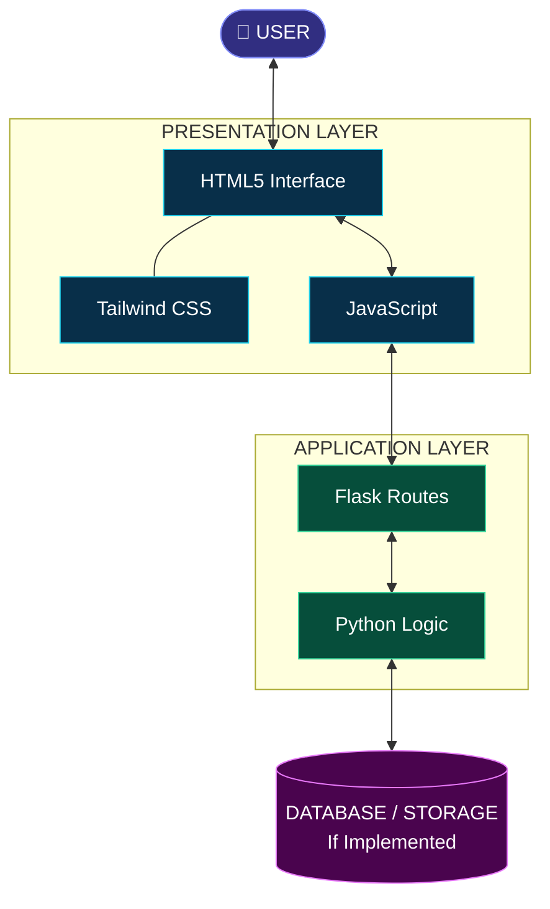
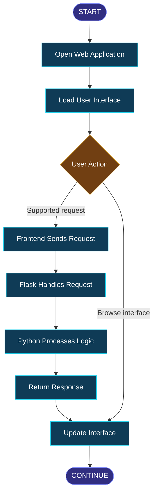

<div align="center">

<a name="top"></a>


<br/>


<br/><br/>

<a href="https://github.com/maahii-in/first-pratice-2021">

</a>
<a href="https://github.com/maahii-in/first-pratice-2021/stargazers">

</a>
<a href="https://github.com/maahii-in/first-pratice-2021/network/members">

</a>

<br/><br/>


<br/><br/>

**A lightweight, web-based note-taking experience inspired by Google Keep.**

*Simple interface · Python-powered backend · Modern web technologies*

</div>

---

<div align="center">

| 📝 Note-taking | 🎨 UI Design | ⚙️ Backend | 🚀 Development |
|:---:|:---:|:---:|:---:|
| Organize ideas | Clean interfaces | Flask & Python | Continuous learning |

</div>

## ✦ Navigation

<div align="center">

<a href="#-project-overview">Overview</a> &nbsp; ◆ &nbsp;
<a href="#-features--capabilities">Features</a> &nbsp; ◆ &nbsp;
<a href="#-technology-stack">Technology</a> &nbsp; ◆ &nbsp;
<a href="#-visual-architecture">Architecture</a> &nbsp; ◆ &nbsp;
<a href="#-github-analytics">Analytics</a> &nbsp; ◆ &nbsp;
<a href="#-installation--setup">Setup</a> &nbsp; ◆ &nbsp;
<a href="#-roadmap">Roadmap</a>

</div>

---

## ✦ Project Overview

<a name="project-overview"></a>

**Google Keep Clone** is a web application inspired by the simplicity of Google Keep. It is built around the idea of capturing information through a straightforward interface while exploring the essential components of full-stack web development.

The project combines Python and Flask on the backend with HTML, Tailwind CSS, and JavaScript on the frontend.

The primary goal is to build practical development experience through application design, server-side programming, frontend-backend communication, and source code management.

<div align="center">

<table>
<tr>
<td width="50%" valign="top">

### 🎯 The Vision

Create a simple, accessible note-taking interface with a clear user experience and an extensible application structure.

</td>
<td width="50%" valign="top">

### 🧠 The Learning Goal

Develop practical skills in web technologies, application architecture, debugging, and professional project documentation.

</td>
</tr>
<tr>
<td width="50%" valign="top">

### 🏗️ The Approach

Use established web technologies to understand how a browser interface connects to server-side application logic.

</td>
<td width="50%" valign="top">

### 🔮 The Possibilities

Explore persistent storage, note organization, search, authentication, and deployment as future improvements.

</td>
</tr>
</table>

</div>

## ✦ Features & Capabilities

<a name="features-capabilities"></a>

<div align="center">

<table>
<tr>
<td align="center" width="33%">

### 🎨

**Modern Interface**

A clean visual foundation with Tailwind CSS.

</td>
<td align="center" width="33%">

### 🐍

**Flask Backend**

Python-based server-side application development.

</td>
<td align="center" width="33%">

### ⚡

**Frontend Logic**

JavaScript for supported browser interactions.

</td>
</tr>
<tr>
<td align="center">

### 🔌

**API Concepts**

Understanding requests, responses, and routes.

</td>
<td align="center">

### 📱

**Responsive Styling**

A foundation for layouts across screen sizes.

</td>
<td align="center">

### 🛠️

**Extensible Design**

A starting point for additional functionality.

</td>
</tr>
</table>

</div>

*These items describe the project's technical focus and intended capabilities. Confirm each feature against the current implementation before presenting it as complete.*

---

## ✦ Technology Stack

<a name="technology-stack"></a>

<div align="center">

<a href="https://www.python.org/">

</a>
&nbsp;&nbsp;
<a href="https://flask.palletsprojects.com/">

</a>
&nbsp;&nbsp;
<a href="https://developer.mozilla.org/en-US/docs/Web/HTML">

</a>
&nbsp;&nbsp;
<a href="https://tailwindcss.com/">

</a>
&nbsp;&nbsp;
<a href="https://developer.mozilla.org/en-US/docs/Web/JavaScript">

</a>
&nbsp;&nbsp;
<a href="https://git-scm.com/">

</a>

</div>

| Technology | Responsibility | Documentation |
|:---|:---|:---|
| **Python** | Backend programming and application logic | [Python Docs](https://docs.python.org/3/) |
| **Flask** | Routing and server-side request handling | [Flask Docs](https://flask.palletsprojects.com/) |
| **HTML5** | Webpage structure and semantic content | [HTML Docs](https://developer.mozilla.org/en-US/docs/Web/HTML) |
| **Tailwind CSS** | Layout, styling, and visual consistency | [Tailwind Docs](https://tailwindcss.com/docs) |
| **JavaScript** | Client-side behavior and interactions | [JavaScript Docs](https://developer.mozilla.org/en-US/docs/Web/JavaScript) |
| **Git & GitHub** | Version control and source code hosting | [Git Docs](https://git-scm.com/doc) |

---

## ✦ Project Showcase

<a name="project-showcase"></a>

<div align="center">


**Application Preview**

*Replace this placeholder with an actual screenshot of your application.*

</div>

<details>
<summary><strong>📸 How to add your own screenshot</strong></summary>

1. Run the application locally.
2. Capture a screenshot of the interface.
3. Create a folder called `assets` in the repository.
4. Upload your screenshot as `assets/homepage.png`.
5. Replace the placeholder image above with:

```html

```

Consider including additional screenshots of note creation, note management, and mobile layouts when those screens are implemented.

</details>

---

## ✦ Visual Architecture

<a name="visual-architecture"></a>

The following diagram illustrates a possible architecture for this type of application.



### Architecture Layers

<table>
<tr>
<td width="33%" valign="top">

**01 — Presentation**

HTML defines the structure, Tailwind CSS handles styling, and JavaScript manages browser-side behavior.

</td>
<td width="33%" valign="top">

**02 — Application**

Flask connects incoming requests to Python application logic and returns appropriate responses.

</td>
<td width="33%" valign="top">

**03 — Persistence**

A database or other storage mechanism may be connected to retain notes between sessions.

</td>
</tr>
</table>

*The diagram is conceptual. Modify it to reflect the actual routes, data flow, and persistence implementation.*

## ✦ Application Workflow



*This workflow illustrates the intended interaction pattern rather than a verified record of every currently implemented operation.*

---

## ✦ GitHub Analytics

<a name="github-analytics"></a>

<div align="center">

### Account Statistics

<a href="https://github.com/maahii-in">

</a>
<a href="https://github.com/maahii-in">

</a>

<br/><br/>

### Contribution Streak


<br/><br/>

### Contribution Activity


<br/><br/>

### Achievement Gallery


</div>

<details>
<summary><strong>📊 About the analytics</strong></summary>

The statistics cards, language distribution, streak tracker, activity graph, and achievement gallery are dynamically provided by third-party services.

- Account statistics describe available GitHub account activity.
- The language graph covers detected languages across the account's repositories.
- The contribution graph and streak represent account-level activity.
- Achievement cards are generated according to the provider's criteria.

These are not project performance measurements. Graphs may require public profile information and may occasionally be unavailable.

</details>

---

## ✦ Repository Structure

```text
first-pratice-2021/
│
├── .vscode/             # Editor configuration
├── templates/           # HTML templates
├── .gitignore           # Files excluded from version control
├── README.md            # Project documentation
├── app_v2.py            # Potential application entry point
├── app.py.txt           # Verify and rename if necessary
├── animi.txt            # Supporting file
├── fasta3.txt           # Supporting file
├── fasta4.txt           # Supporting file
├── fastmain.txt         # Supporting file
└── info.txt             # Project information
```

*The tree reflects the repository information visible in the provided screenshot. Update the filenames and descriptions after reviewing the actual source files.*

---

## ✦ Installation & Setup

<a name="installation-setup"></a>

### Prerequisites

- Python 3
- pip
- Git
- A modern web browser

### Step 01 — Clone the repository

```bash
git clone https://github.com/maahii-in/first-pratice-2021.git
cd first-pratice-2021
```

### Step 02 — Create a virtual environment

```bash
python -m venv venv
```

### Step 03 — Activate the environment

**Windows**

```powershell
venv\Scripts\activate
```

**macOS / Linux**

```bash
source venv/bin/activate
```

### Step 04 — Install dependencies

If `requirements.txt` exists:

```bash
pip install -r requirements.txt
```

Otherwise, install the packages required by the code. For a basic Flask application:

```bash
pip install Flask
```

### Step 05 — Start the application

If `app_v2.py` is the actual entry point:

```bash
python app_v2.py
```

Otherwise, substitute the correct Python filename.

### Step 06 — Open the application

Navigate to the local URL printed in the terminal. Flask's default development URL is commonly:

```text
http://127.0.0.1:5000
```

> **Development note:** Flask's development server is intended for local development and testing. Use an appropriate production server and deployment configuration when publishing the application.

---

## ✦ Development Standards

To keep the project maintainable as it evolves:

| Area | Recommended Practice |
|:---|:---|
| Code quality | Use descriptive names and keep functions focused |
| Configuration | Separate environment-specific settings from source code |
| Dependencies | Maintain an accurate `requirements.txt` |
| Security | Never commit passwords, tokens, or secret keys |
| Testing | Verify routes and functionality after changes |
| Documentation | Keep setup instructions aligned with the code |
| Version control | Use focused commits and meaningful branch names |

## ✦ Roadmap

<div align="center">

| Phase | Milestone | Status |
|:---:|:---|:---:|
| 01 | Flask application foundation | Review |
| 02 | Frontend interface | Review |
| 03 | Frontend-backend integration | Review |
| 04 | Complete note management | Planned |
| 05 | Search and categorization | Planned |
| 06 | Database persistence | Planned |
| 07 | Authentication and authorization | Planned |
| 08 | Automated testing | Planned |
| 09 | Production deployment | Planned |

</div>

<details>
<summary><strong>🚀 Future feature ideas</strong></summary>

**Note management**
- Create, edit, and delete notes.
- Pin important notes.
- Archive and restore notes.

**Organization**
- Search by title or content.
- Add labels and categories.
- Apply custom note colors.

**Reliability**
- Persist notes in a database.
- Add automated tests.
- Improve accessibility and error handling.

**Deployment**
- Configure production environment variables.
- Deploy through a suitable hosting platform.
- Document setup and maintenance procedures.

These items are suggestions for future development, not confirmed features of the existing implementation.

</details>

---

## ✦ Contributing

Contributions, constructive feedback, and improvements are welcome.

1. Fork the repository.
2. Create a feature branch.
3. Implement your changes.
4. Test the updated functionality.
5. Commit your work with a descriptive message.
6. Submit a pull request explaining the improvement.

Example:

```bash
git checkout -b feature/note-search
git add .
git commit -m "Add note search functionality"
git push -u origin feature/note-search
```

Only use a feature branch when you are ready to implement that feature.

## ✦ Security

Please avoid publishing passwords, API keys, access tokens, or private configuration values.

Validate incoming data on the server, protect any user-specific resources, and review dependencies before deploying the application.

## ✦ License

No license has been confirmed for this project. Add a `LICENSE` file before specifying reuse, redistribution, or modification terms.

---

## ✦ About the Developer

<div align="center">

<a href="https://github.com/maahii-in">

</a>

### MAHI BUDATI

**Aspiring Developer · Python · Flask · Web Development**

Building practical projects to strengthen software development skills, explore new technologies, and turn ideas into working applications.

<br/>

<a href="https://github.com/maahii-in">

</a>

<br/><br/>

<a href="https://github.com/maahii-in/first-pratice-2021">

</a>

<br/><br/>

### Thank you for visiting!

*Every project is an opportunity to learn, build, and improve.*


<a href="#top">↑ Back to Top</a>

</div>

<!-- End of README.md -->

