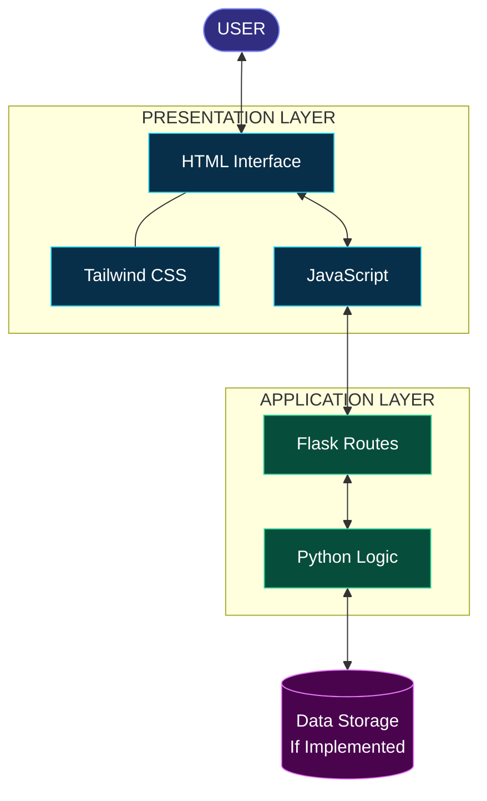
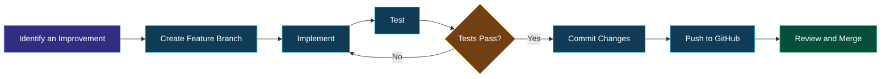
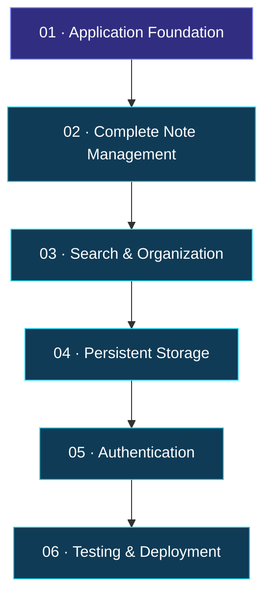

<div align="center">

<a id="top"></a>


<br/>


<br/><br/>

<a href="https://github.com/maahii-in/first-pratice-2021">

</a>
<a href="https://github.com/maahii-in/first-pratice-2021/stargazers">

</a>
<a href="https://github.com/maahii-in/first-pratice-2021/network/members">

</a>
<a href="https://github.com/maahii-in/first-pratice-2021/commits">

</a>

<br/><br/>


<br/><br/>

### ✦ A Modern Approach to Digital Note-Taking ✦

*A lightweight web application inspired by Google Keep, developed to explore full-stack web technologies.*

<br/>

</div>

---

<div align="center">

### ◈ NAVIGATE THE EXPERIENCE ◈

<table>
<tr>
<td align="center"><a href="#-01--project-introduction">01 · Overview</a></td>
<td align="center"><a href="#-02--design-philosophy">02 · Design</a></td>
<td align="center"><a href="#-03--feature-gallery">03 · Features</a></td>
<td align="center"><a href="#-04--technology-universe">04 · Technology</a></td>
</tr>
<tr>
<td align="center"><a href="#-05--product-showcase">05 · Showcase</a></td>
<td align="center"><a href="#-06--github-dashboard">06 · Analytics</a></td>
<td align="center"><a href="#-07--system-blueprint">07 · Architecture</a></td>
<td align="center"><a href="#-08--installation-studio">08 · Installation</a></td>
</tr>
<tr>
<td align="center"><a href="#-09--development-workflow">09 · Workflow</a></td>
<td align="center"><a href="#-10--project-roadmap">10 · Roadmap</a></td>
<td align="center"><a href="#-11--quality-and-security">11 · Quality</a></td>
<td align="center"><a href="#-12--the-developer">12 · Developer</a></td>
</tr>
</table>

</div>

---

<div align="center">


# 01 · PROJECT INTRODUCTION

### Ideas are valuable. Organizing them should be simple.

</div>

**Google Keep Clone** is a web application inspired by the simplicity of Google Keep. It combines a Python and Flask backend with a frontend built using HTML, Tailwind CSS, and JavaScript.

The project provides a practical environment for exploring full-stack web development, understanding the relationship between frontend and backend components, and developing good software documentation and version-control practices.

<div align="center">

<table>
<tr>
<td width="50%" valign="top">

### ◉ The Vision

Create a straightforward note-taking experience that prioritizes clarity, simplicity, and a clean interface.

</td>
<td width="50%" valign="top">

### ◈ The Mission

Develop practical knowledge of Python, Flask, frontend technologies, and application architecture.

</td>
</tr>
<tr>
<td width="50%" valign="top">

### ⬡ The Approach

Use familiar web technologies to understand how interactive interfaces connect to server-side application logic.

</td>
<td width="50%" valign="top">

### ✧ The Future

Explore persistent storage, improved organization, authentication, testing, and deployment as potential extensions.

</td>
</tr>
</table>

</div>

## The thinking behind the project

A useful note-taking application should make information easy to capture, understand, and revisit. This project explores the technical foundations required to build that experience.

- **Simplicity:** Keep the interface understandable.
- **Structure:** Separate presentation and application logic.
- **Maintainability:** Use readable, organized code.
- **Growth:** Build a foundation that supports future development.

---

<div align="center">


# 02 · DESIGN PHILOSOPHY

### A visual language inspired by modern developer tools

</div>

<div align="center">

<table>
<tr>
<td align="center" width="25%">


**Midnight**

<br/>

A deep, focused foundation.

</td>
<td align="center" width="25%">


**Indigo**

<br/>

A distinctive visual identity.

</td>
<td align="center" width="25%">


**Electric Violet**

<br/>

A modern accent color.

</td>
<td align="center" width="25%">


**Cyan**

<br/>

A crisp technical highlight.

</td>
</tr>
</table>

</div>

The README uses a consistent visual vocabulary across banners, badges, diagrams, navigation, and profile elements. The aim is to present the repository like a small software product rather than a plain list of files.

<div align="center">

**CLARITY** &nbsp; ◆ &nbsp; **CONSISTENCY** &nbsp; ◆ &nbsp; **FUNCTIONALITY** &nbsp; ◆ &nbsp; **CONTINUOUS IMPROVEMENT**

</div>

---

<div align="center">


# 03 · FEATURE GALLERY

### The building blocks of the experience

</div>

<table>
<tr>
<td width="50%" valign="top">

### 🎨 Interface Experience

A clean frontend foundation designed around readable content and consistent styling.

- HTML-based page structure
- Tailwind CSS styling
- Clear visual hierarchy
- Responsive layout as a design goal

</td>
<td width="50%" valign="top">

### 🐍 Backend Engineering

A Python-based backend using Flask.

- Server-side application logic
- Flask routing
- HTTP request handling
- API integration where implemented

</td>
</tr>
<tr>
<td width="50%" valign="top">

### ⚡ Browser Interactions

JavaScript provides the foundation for client-side behavior.

- Event handling
- Frontend interaction patterns
- Communication with backend endpoints
- Dynamic updates where implemented

</td>
<td width="50%" valign="top">

### 🚀 Future Capabilities

Potential features for future development include:

- Search and filtering
- Note editing and deletion
- Data persistence
- User accounts and personalization

</td>
</tr>
</table>

<details>
<summary><strong>✦ Potential note-taking enhancements</strong></summary>

**Note management**
- Create and edit notes.
- Delete unwanted notes.
- Pin important content.
- Archive and restore notes.

**Organization**
- Search note titles and contents.
- Categorize notes using labels.
- Introduce customizable colors.

**Personalization**
- Add user authentication.
- Keep user-specific notes separate.
- Improve accessibility and responsive behavior.

These are possible extensions, not a claim that the current application already implements them.

</details>

---

<div align="center">


# 04 · TECHNOLOGY UNIVERSE

### A modern foundation for full-stack learning

<br/>

<a href="https://www.python.org/">

</a>
&nbsp;&nbsp;&nbsp;
<a href="https://flask.palletsprojects.com/">

</a>
&nbsp;&nbsp;&nbsp;
<a href="https://developer.mozilla.org/en-US/docs/Web/HTML">

</a>
&nbsp;&nbsp;&nbsp;
<a href="https://tailwindcss.com/">

</a>
&nbsp;&nbsp;&nbsp;
<a href="https://developer.mozilla.org/en-US/docs/Web/JavaScript">

</a>
&nbsp;&nbsp;&nbsp;
<a href="https://git-scm.com/">

</a>

</div>

| Technology | Responsibility | Documentation |
|---|---|---|
| Python | Backend programming and application logic | [Python](https://docs.python.org/3/) |
| Flask | Server-side framework and request routing | [Flask](https://flask.palletsprojects.com/) |
| HTML5 | Webpage structure and semantics | [HTML](https://developer.mozilla.org/en-US/docs/Web/HTML) |
| Tailwind CSS | Styling and layout | [Tailwind](https://tailwindcss.com/docs) |
| JavaScript | Client-side interactions | [JavaScript](https://developer.mozilla.org/en-US/docs/Web/JavaScript) |
| Git | Version control | [Git](https://git-scm.com/doc) |
| GitHub | Code hosting and collaboration | [GitHub Docs](https://docs.github.com/) |

<div align="center">

### Technology flow

`HTML` + `Tailwind CSS` + `JavaScript` &nbsp; → &nbsp; `Flask` &nbsp; → &nbsp; `Python Logic`

</div>

---

<div align="center">


# 05 · PRODUCT SHOWCASE

### An actual view of the application belongs here

</div>

<div align="center">

<!-- Upload your real screenshot to assets/homepage.png, then uncomment the image below. -->

<!--  -->


<sub>Replace this placeholder with a screenshot captured from your running application.</sub>

</div>

### Build a visual story

<div align="center">

<table>
<tr>
<td width="33%" align="center">

### 01

**The Main Interface**

<br/>

Show the application's actual opening screen.

</td>
<td width="33%" align="center">

### 02

**An Interaction**

<br/>

Show an implemented note creation or editing flow.

</td>
<td width="33%" align="center">

### 03

**Responsive Layout**

<br/>

Show the application on a smaller screen.

</td>
</tr>
</table>

</div>

<details>
<summary><strong>📸 How to add your screenshots</strong></summary>

Create a folder named `assets` in the repository.

Upload a screenshot and name it `homepage.png`.

Then replace the placeholder with:

```html

```

For additional screenshots, use descriptive filenames such as `note-editor.png` and `mobile-view.png`.

Only include screenshots that reflect the actual application.

</details>

---

<div align="center">


# 06 · GITHUB DASHBOARD

### Development activity and account statistics

</div>

<div align="center">

<a href="https://github.com/maahii-in">

</a>
<a href="https://github.com/maahii-in">

</a>

<br/><br/>

### Contribution streak


<br/><br/>

### Activity visualization


<br/><br/>

### Achievement collection


<br/><br/>

<a href="https://github.com/maahii-in?tab=repositories">

</a>

</div>

<details>
<summary><strong>📊 How to interpret the graphs</strong></summary>

These graphics are generated by third-party services using available GitHub information.

- **Account statistics** summarize available profile activity.
- **Language distribution** reflects languages detected across the account's repositories.
- **Contribution streak** visualizes activity according to the provider's criteria.
- **Activity graph** presents historical contribution activity.
- **Achievement gallery** displays calculated profile trophies.

The graphs are account-level visualizations, not measurements of this project's performance. They may depend on public account information and third-party service availability.

</details>

---

<div align="center">


# 07 · SYSTEM BLUEPRINT

### Understanding the connection between components

</div>



### Component responsibilities

<table>
<tr>
<td width="33%" valign="top">

**01 · Presentation**

HTML defines page structure, Tailwind CSS handles styling, and JavaScript supports browser interactions.

</td>
<td width="33%" valign="top">

**02 · Application**

Flask routes requests to Python application logic and returns responses to the client.

</td>
<td width="33%" valign="top">

**03 · Persistence**

A database or another storage mechanism can be introduced to retain notes between sessions.

</td>
</tr>
</table>

### Request lifecycle


*Both diagrams describe a conventional design and should be updated to match the implemented application.*

---

<div align="center">


# 08 · PROJECT STRUCTURE

### Keep the codebase organized and understandable

</div>

```text
first-pratice-2021/
│
├── .vscode/             # Editor configuration
├── templates/           # HTML templates
├── .gitignore           # Git ignore rules
├── README.md            # Project documentation
├── app_v2.py            # Potential application entry point
├── app.py.txt           # Verify filename and contents
├── animi.txt            # Supporting file
├── fasta3.txt           # Supporting file
├── fasta4.txt           # Supporting file
├── fastmain.txt         # Supporting file
└── info.txt             # Project information
```

This tree reflects the visible repository structure provided earlier. Verify the purpose of each file before finalizing its description.

**Recommended cleanup:** If `app.py.txt` contains your Python application code, consider renaming it to `app.py`. Also identify the actual startup file and document it consistently.

---

<div align="center">


# 09 · INSTALLATION STUDIO

### From repository to local development environment

</div>

## System requirements

| Requirement | Purpose |
|---|---|
| Python 3 | Run the application backend |
| pip | Install dependencies |
| Git | Retrieve and manage source code |
| Modern browser | Access the web application |

## Step 01 — Clone the repository

```bash
git clone https://github.com/maahii-in/first-pratice-2021.git
cd first-pratice-2021
```

## Step 02 — Create a virtual environment

```bash
python -m venv venv
```

## Step 03 — Activate the environment

**Windows**

```powershell
venv\Scripts\activate
```

**macOS / Linux**

```bash
source venv/bin/activate
```

## Step 04 — Install the dependencies

If the project includes a `requirements.txt` file:

```bash
pip install -r requirements.txt
```

Otherwise, install the dependencies used by the application. For a basic Flask backend:

```bash
pip install Flask
```

Add other packages required by the actual source code.

## Step 05 — Start the server

If `app_v2.py` is the correct entry point:

```bash
python app_v2.py
```

Use the appropriate filename if the application starts from another module.

## Step 06 — Access the application

Open the address displayed in the terminal. The default Flask development address is commonly:

```text
http://127.0.0.1:5000
```

<details>
<summary><strong>⚠️ Troubleshooting</strong></summary>

**Python is not recognized**

Check your Python installation and ensure it is available on your system PATH.

**Module not found**

Activate the virtual environment and install the missing dependency.

**Port already in use**

Check which application occupies the port and configure an available port if appropriate.

**Application fails to start**

Read the terminal traceback, confirm the entry-point filename, and verify that the required dependencies are installed.

**Page not found**

Check the Flask routes and ensure the requested URL is defined by the application.

</details>

> Flask's development server is intended for local development and testing. Use a production-appropriate WSGI server and deployment configuration when publishing the application.

---

<div align="center">


# 10 · DEVELOPMENT WORKFLOW

### A repeatable process for building better software

</div>



### Example Git workflow

```bash
git checkout -b feature/note-search
git add .
git commit -m "Add note search functionality"
git push -u origin feature/note-search
```

These are example commands for future feature development. Adjust the branch name and commit message to match the changes you actually make.

---

<div align="center">


# 11 · QUALITY & SECURITY

### Engineering habits that make projects stronger

</div>

<table>
<tr>
<td width="50%" valign="top">

### 🧹 Code quality

- [ ] Use descriptive identifiers.
- [ ] Keep functions focused.
- [ ] Avoid unnecessary duplication.
- [ ] Maintain a clear repository structure.

</td>
<td width="50%" valign="top">

### 🔐 Security

- [ ] Do not commit secrets.
- [ ] Validate incoming data.
- [ ] Review dependencies.
- [ ] Protect user-specific resources if introduced.

</td>
</tr>
<tr>
<td width="50%" valign="top">

### 🧪 Testing

- [ ] Verify startup.
- [ ] Test implemented routes.
- [ ] Check supported user interactions.
- [ ] Investigate errors after changes.

</td>
<td width="50%" valign="top">

### 📚 Documentation

- [ ] Maintain accurate setup instructions.
- [ ] Document dependencies.
- [ ] Add real application screenshots.
- [ ] Update feature descriptions as the code changes.

</td>
</tr>
</table>

## Learning outcomes

| Area | Development objective |
|---|---|
| Backend engineering | Learn Flask routing and Python application logic |
| Frontend engineering | Explore HTML, Tailwind CSS, and JavaScript |
| Integration | Understand HTTP request-response communication |
| Debugging | Develop systematic problem-solving habits |
| Version control | Practice commits, branches, and repository management |
| Documentation | Communicate technical decisions clearly |

---

<div align="center">


# 12 · PRODUCT ROADMAP

### A foundation for continuous improvement

</div>



| Milestone | Objective | Status |
|---|---|---|
| 01 | Review and document the current application | Review |
| 02 | Implement complete note management | Planned |
| 03 | Add search, labels, and categories | Planned |
| 04 | Introduce persistent database storage | Planned |
| 05 | Add user authentication and access controls | Planned |
| 06 | Introduce automated testing | Planned |
| 07 | Prepare deployment configuration | Planned |

<details>
<summary><strong>Phase A — Note management</strong></summary>

Create, edit, delete, pin, archive, and restore notes as appropriate.

</details>

<details>
<summary><strong>Phase B — Organization</strong></summary>

Introduce search, labels, categories, and optional color coding.

</details>

<details>
<summary><strong>Phase C — Data persistence</strong></summary>

Integrate a suitable database, validate incoming data, and handle database errors.

</details>

<details>
<summary><strong>Phase D — User accounts</strong></summary>

Add authentication, secure sessions, and authorization for user-specific notes.

</details>

<details>
<summary><strong>Phase E — Production readiness</strong></summary>

Add testing, deployment configuration, logging, and appropriate error handling.

</details>

*Update the milestone statuses to reflect actual progress. Planned work should not be presented as completed functionality.*

---

<div align="center">


# 13 · CONTRIBUTION

### Good ideas grow through collaboration

</div>

Contributions, suggestions, and constructive feedback are welcome.

1. Fork the repository.
2. Create a dedicated feature branch.
3. Make a focused improvement.
4. Test the updated functionality.
5. Commit your work with a descriptive message.
6. Submit a pull request outlining your changes.

## Security

Avoid publishing passwords, API keys, personal access tokens, or other sensitive credentials. Review input validation, access control, environment configuration, and dependency security before deployment.

## License

No license has been confirmed for this repository. Add a `LICENSE` file to define the permissions for using, modifying, and distributing the project.

---

<div align="center">


# 14 · THE DEVELOPER


<br/><br/>

<a href="https://github.com/maahii-in">

</a>

## MAHI BUDATI

**Aspiring Developer · Python · Flask · Web Development**

Exploring modern web technologies, building practical applications, and improving software development skills through hands-on projects.

<br/>

<a href="https://github.com/maahii-in">

</a>

<a href="https://github.com/maahii-in/first-pratice-2021">

</a>

<br/><br/>

### The next improvement starts with one line of code.

*Learn continuously. Build thoughtfully. Improve consistently.*

<br/><br/>

<a href="https://github.com/maahii-in/first-pratice-2021/stargazers">

</a>

<br/><br/>

<a href="#top">

</a>


</div>

<!-- END OF README -->

