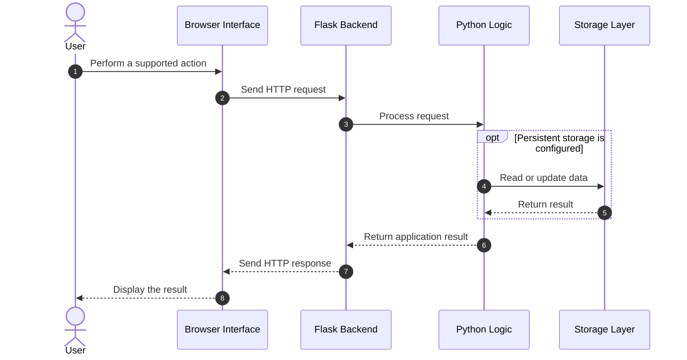
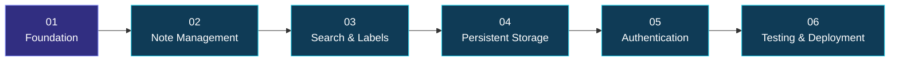

<div align="center">

<a id="top"></a>


<br/>


<br/><br/>

<a href="https://github.com/maahii-in/first-pratice-2021">

</a>
<a href="https://github.com/maahii-in/first-pratice-2021/stargazers">

</a>
<a href="https://github.com/maahii-in/first-pratice-2021/network/members">

</a>
<a href="https://github.com/maahii-in/first-pratice-2021/commits">

</a>

<br/><br/>


<br/><br/>

### A Minimalist Approach to Digital Note-Taking

*A web development project inspired by Google Keep, built with Python, Flask, and modern frontend technologies.*

<br/>

</div>

---

<div align="center">

## ◈ PROJECT DASHBOARD

</div>

<table>
<tr>
<td align="center" width="25%">


**PROJECT**

<br/>

Google Keep Clone

</td>
<td align="center" width="25%">


**BACKEND**

<br/>

Python + Flask

</td>
<td align="center" width="25%">


**FRONTEND**

<br/>

HTML + Tailwind CSS

</td>
<td align="center" width="25%">


**PURPOSE**

<br/>

Full-Stack Learning

</td>
</tr>
</table>

<div align="center">

### Quick Navigation

<a href="#-01--about-the-project">ABOUT</a> &nbsp; ◆ &nbsp;
<a href="#-02--visual-feature-gallery">FEATURES</a> &nbsp; ◆ &nbsp;
<a href="#-03--technology-stack">TECH STACK</a> &nbsp; ◆ &nbsp;
<a href="#-04--product-showcase">SHOWCASE</a> &nbsp; ◆ &nbsp;
<a href="#-05--github-analytics">GRAPHS</a> &nbsp; ◆ &nbsp;
<a href="#-06--system-design">ARCHITECTURE</a> &nbsp; ◆ &nbsp;
<a href="#-08--installation">SETUP</a> &nbsp; ◆ &nbsp;
<a href="#-10--developer-profile">DEVELOPER</a>

</div>

---

<div align="center">


### Ideas deserve a beautiful place.

</div>

**Google Keep Clone** is a lightweight web application inspired by the simplicity of Google Keep. It combines a Python and Flask backend with a frontend built using HTML, Tailwind CSS, and JavaScript.

The project explores the foundations of full-stack web development, including interface design, server-side logic, frontend-backend communication, and source code management with Git and GitHub.

<div align="center">

<table>
<tr>
<td width="50%" valign="top">

### 🎯 The Vision

Create a simple and intuitive note-taking experience with a clean interface and a maintainable application structure.

</td>
<td width="50%" valign="top">

### 💡 The Approach

Use established web technologies to understand the complete lifecycle of a browser-based application.

</td>
</tr>
<tr>
<td width="50%" valign="top">

### 🧠 The Learning

Explore Flask routing, Python logic, web styling, JavaScript interactions, and software documentation.

</td>
<td width="50%" valign="top">

### 🚀 The Opportunity

Use the project as a foundation for future work in persistence, search, authentication, and deployment.

</td>
</tr>
</table>

</div>

> **Design principle:** Keep the experience simple, the code understandable, and the architecture flexible enough to improve over time.

---

<div align="center">


### Built around simplicity. Designed for growth.

</div>

<table>
<tr>
<td width="50%" valign="top">

<div align="center">


### 🎨 Interface Design

</div>

Explore clean layouts, readable content, and consistent visual styling through HTML and Tailwind CSS.

**Focus areas**

- Clear page structure
- Consistent styling
- Usable visual hierarchy
- Responsive layout as a design goal

</td>
<td width="50%" valign="top">

<div align="center">


### ⚙️ Backend Engineering

</div>

Develop a Python-based backend using Flask for server-side application logic.

**Focus areas**

- Application routes
- HTTP request handling
- Python logic
- Backend integration

</td>
</tr>
<tr>
<td width="50%" valign="top">

<div align="center">


### ⚡ Client-Side Interaction

</div>

Use JavaScript to explore how browser interactions connect to server-side functionality.

**Focus areas**

- Event handling
- Client-side behavior
- API communication where implemented
- Dynamic updates where implemented

</td>
<td width="50%" valign="top">

<div align="center">


### 🚀 Future Potential

</div>

Expand the application with additional capabilities as the project develops.

**Potential improvements**

- Search and filtering
- Note editing and deletion
- Persistent database storage
- Authentication and personalization

</td>
</tr>
</table>

<details>
<summary><strong>✦ Explore future feature possibilities</strong></summary>

| Capability | Potential benefit |
|:---|:---|
| Note management | Create, edit, delete, pin, and archive notes |
| Search | Find content efficiently |
| Labels and categories | Organize information |
| Colors | Visually distinguish notes |
| Database integration | Preserve data between sessions |
| Authentication | Support individual user accounts |

These items are possible enhancements. Describe them as completed features only after confirming they work in the application.

</details>

---

<div align="center">


### The tools powering the project

<br/>

<a href="https://www.python.org/">

</a>
&nbsp;&nbsp;&nbsp;
<a href="https://flask.palletsprojects.com/">

</a>
&nbsp;&nbsp;&nbsp;
<a href="https://developer.mozilla.org/en-US/docs/Web/HTML">

</a>
&nbsp;&nbsp;&nbsp;
<a href="https://tailwindcss.com/">

</a>
&nbsp;&nbsp;&nbsp;
<a href="https://developer.mozilla.org/en-US/docs/Web/JavaScript">

</a>
&nbsp;&nbsp;&nbsp;
<a href="https://git-scm.com/">

</a>

</div>

<table>
<tr>
<th align="left">Technology</th>
<th align="left">Role</th>
<th align="left">Documentation</th>
</tr>
<tr>
<td>🐍 Python</td>
<td>Backend programming</td>
<td><a href="https://docs.python.org/3/">Python Docs</a></td>
</tr>
<tr>
<td>🌶️ Flask</td>
<td>Web framework and request routing</td>
<td><a href="https://flask.palletsprojects.com/">Flask Docs</a></td>
</tr>
<tr>
<td>🌐 HTML5</td>
<td>Page structure and content</td>
<td><a href="https://developer.mozilla.org/en-US/docs/Web/HTML">HTML Docs</a></td>
</tr>
<tr>
<td>🎨 Tailwind CSS</td>
<td>Styling and layout</td>
<td><a href="https://tailwindcss.com/docs">Tailwind Docs</a></td>
</tr>
<tr>
<td>⚡ JavaScript</td>
<td>Client-side interactions</td>
<td><a href="https://developer.mozilla.org/en-US/docs/Web/JavaScript">JavaScript Docs</a></td>
</tr>
<tr>
<td>🔀 Git</td>
<td>Version control</td>
<td><a href="https://git-scm.com/doc">Git Docs</a></td>
</tr>
<tr>
<td>🐙 GitHub</td>
<td>Code hosting and collaboration</td>
<td><a href="https://docs.github.com/">GitHub Docs</a></td>
</tr>
</table>

<div align="center">

`PRESENTATION` &nbsp; → &nbsp; `APPLICATION LOGIC` &nbsp; → &nbsp; `RESPONSE`

</div>

---

<div align="center">


### Don't just show the code. Show the experience.

</div>

<div align="center">

<!-- Upload your actual screenshot to assets/preview.png. -->
<!-- Then uncomment the image below. -->

<!--  -->


<sub>Replace the placeholder with a screenshot from your running application.</sub>

</div>

<div align="center">

| 🖥️ Desktop | ✍️ Note Interaction | 📱 Mobile |
|:---:|:---:|:---:|
| Main application interface | An implemented user workflow | Responsive application view |

</div>

<details>
<summary><strong>📸 Add your own screenshots</strong></summary>

1. Create an `assets` folder in your repository.
2. Upload your application screenshot as `assets/preview.png`.
3. Replace the placeholder image with the following:

```html

```

You can add more screenshots for different pages or states. Use genuine application screenshots rather than generic placeholder graphics.

</details>

---

<div align="center">


### Developer activity at a glance

</div>

<div align="center">

<a href="https://github.com/maahii-in">

</a><a href="https://github.com/maahii-in">

</a>

<br/><br/>

### Contribution Streak


<br/><br/>

### Contribution Activity


<br/><br/>

### Achievement Gallery


<br/><br/>

<a href="https://github.com/maahii-in?tab=repositories">

</a>

</div>

<details>
<summary><strong>📊 Understanding the graphs</strong></summary>

These visualizations are generated dynamically by external services.

- Account statistics show available profile-level information.
- The language chart covers detected languages across the account's repositories.
- The streak tracker displays qualifying contribution activity.
- The activity graph presents contribution history.
- The achievement cards display trophies calculated by the provider.

These are account-level statistics, not verified measures of this individual project's quality or performance. Availability depends on third-party services and public account data.

</details>

---

<div align="center">


### A visual representation of the application

</div>


### Request lifecycle



*These diagrams represent a conventional architecture and workflow. Adjust them to match the actual implementation.*

---

<div align="center">


### Organized code makes better projects

</div>

```text
first-pratice-2021/
│
├── .vscode/           # Editor configuration
├── templates/         # HTML templates
├── .gitignore         # Git ignore configuration
├── README.md          # Project documentation
├── app_v2.py          # Potential application entry point
├── app.py.txt         # Verify and rename if appropriate
├── animi.txt          # Supporting file
├── fasta3.txt         # Supporting file
├── fasta4.txt         # Supporting file
├── fastmain.txt       # Supporting file
└── info.txt           # Project information
```

The structure reflects the files visible in your repository screenshot. Verify the purpose of each file before finalizing this section.

**Recommended cleanup:** If `app.py.txt` contains your actual Python application code, rename it to `app.py` if appropriate and document the correct startup command.

---

<div align="center">


### From source code to a running application

</div>

### Requirements

- Python 3
- pip
- Git
- A modern web browser

### 01 — Clone the repository

```bash
git clone https://github.com/maahii-in/first-pratice-2021.git
cd first-pratice-2021
```

### 02 — Create a virtual environment

```bash
python -m venv venv
```

### 03 — Activate the environment

**Windows**

```powershell
venv\Scripts\activate
```

**macOS / Linux**

```bash
source venv/bin/activate
```

### 04 — Install dependencies

If `requirements.txt` exists:

```bash
pip install -r requirements.txt
```

Otherwise, install the dependencies actually used by the application. For a basic Flask application:

```bash
pip install Flask
```

### 05 — Run the application

If `app_v2.py` is the main entry point:

```bash
python app_v2.py
```

Replace the filename if a different file starts the Flask application.

### 06 — Open the application

Visit the local address shown in your terminal, commonly:

```text
http://127.0.0.1:5000
```

<details>
<summary><strong>⚠️ Common problems and solutions</strong></summary>

| Problem | Suggested action |
|---|---|
| Python is not recognized | Verify the Python installation and PATH |
| Missing module | Activate the environment and install the required package |
| Application fails to start | Inspect the traceback and verify the entry point |
| Page returns 404 | Check the configured Flask routes |
| Port already in use | Check which process occupies the port |

</details>

> Use Flask's development server for local development and testing. Production deployment requires an appropriate server and configuration.

---

<div align="center">


### A foundation for continuous improvement

</div>



| Milestone | Objective | Status |
|---|---|---|
| 01 | Review and document the existing application | Review |
| 02 | Complete note creation, editing, and deletion | Planned |
| 03 | Add search and organization | Planned |
| 04 | Integrate persistent storage | Planned |
| 05 | Add authentication and access controls | Planned |
| 06 | Introduce automated tests | Planned |
| 07 | Prepare production deployment | Planned |

### Potential feature extensions

<details>
<summary><strong>📝 Note management</strong></summary>

Create, edit, delete, pin, archive, and restore notes.

</details>

<details>
<summary><strong>🔎 Search and organization</strong></summary>

Introduce text search, labels, categories, and optional color coding.

</details>

<details>
<summary><strong>💾 Persistent storage</strong></summary>

Use SQLite or another suitable database to preserve user data between sessions.

</details>

<details>
<summary><strong>🔐 Authentication</strong></summary>

Introduce accounts, secure sessions, and authorization for private notes.

</details>

<details>
<summary><strong>🚀 Deployment</strong></summary>

Add automated testing, production settings, deployment instructions, and error monitoring.

</details>

*Roadmap items represent future possibilities. Update their status as features are implemented and tested.*

---

<div align="center">


<br/><br/>

<a href="https://github.com/maahii-in">

</a>

# MAHI BUDATI

### Aspiring Developer · Python · Flask · Web Development

Building practical applications, exploring new technologies, and improving through hands-on software development.

<br/>

<a href="https://github.com/maahii-in">

</a>
<a href="https://github.com/maahii-in/first-pratice-2021">

</a>

<br/><br/>

### ✦ Built with curiosity. Improved through practice. ✦

*Learn continuously. Build thoughtfully. Improve consistently.*

<br/><br/>

<a href="https://github.com/maahii-in/first-pratice-2021/stargazers">

</a>

<br/><br/>

<a href="#top">

</a>


</div>

