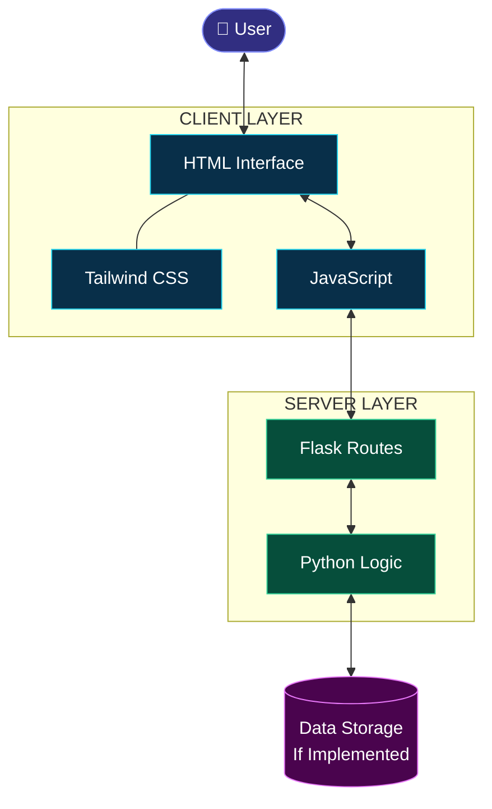
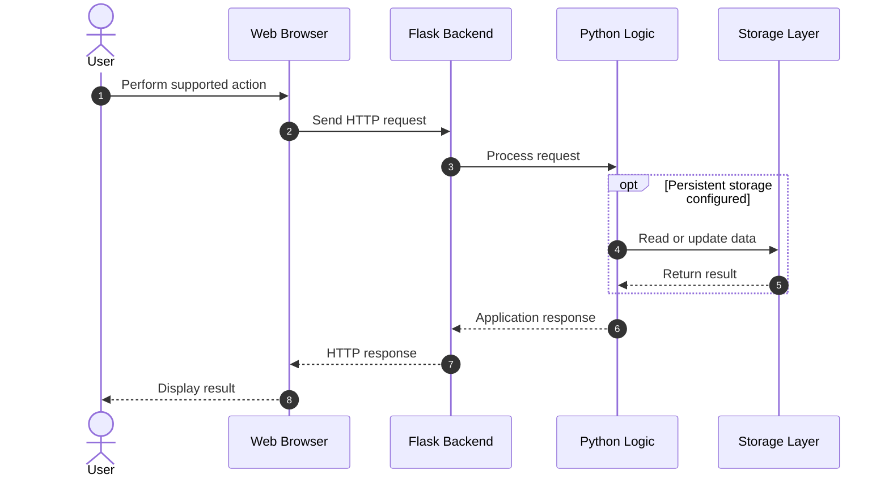
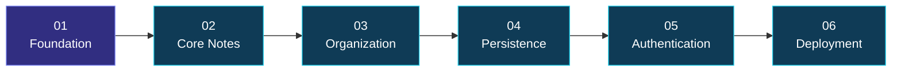
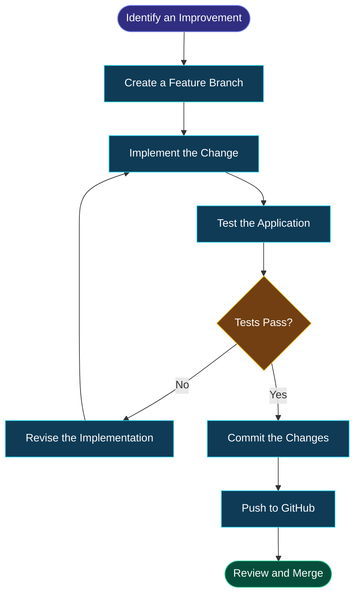

<div align="center">

<a id="top"></a>


<br/>


<br/><br/>

<a href="https://github.com/maahii-in/first-pratice-2021">

</a>
<a href="https://github.com/maahii-in/first-pratice-2021/stargazers">

</a>
<a href="https://github.com/maahii-in/first-pratice-2021/network/members">

</a>

<br/><br/>


<br/><br/>

**A lightweight note-taking application inspired by Google Keep.**

*Thoughtfully designed · Built for learning · Ready to evolve*

<br/>

</div>

---

<div align="center">

### ◆ Explore the Project ◆

[Overview](#-overview) · [Features](#-experience--features) · [Technology](#-technology-stack) · [Analytics](#-github-analytics) · [Architecture](#-system-architecture) · [Setup](#-getting-started) · [Roadmap](#-product-roadmap) · [Developer](#-developer)

</div>

---

# ◈ 01 — Overview

<div align="center">

### Ideas deserve a better place.

</div>

**Google Keep Clone** is a web application inspired by the simplicity of digital note-taking. It combines a Python and Flask backend with a frontend developed using HTML, Tailwind CSS, and JavaScript.

The project explores the foundations of full-stack web development, from designing a user interface to understanding server-side logic and frontend-backend communication.

<div align="center">

<table>
<tr>
<td align="center" width="25%">

<h3>01</h3>

**Capture**

<br/>

A foundation for collecting ideas and information.

</td>
<td align="center" width="25%">

<h3>02</h3>

**Organize**

<br/>

A starting point for structuring digital notes.

</td>
<td align="center" width="25%">

<h3>03</h3>

**Connect**

<br/>

Explore communication between frontend and backend.

</td>
<td align="center" width="25%">

<h3>04</h3>

**Improve**

<br/>

Expand the project through continuous development.

</td>
</tr>
</table>

</div>

## ✦ Project Philosophy

> Great software does not need to be complicated. It needs to solve a problem clearly, remain understandable, and provide room for improvement.

This project emphasizes simplicity, readability, practical learning, and a foundation that can grow into a more complete application.

---

# ◈ 02 — Experience & Features

<div align="center">

### Designed around simplicity. Built around fundamentals.

</div>

<div align="center">

<table>
<tr>
<td width="50%" valign="top">

### 🎨 Interface Design

A clean visual foundation focused on clarity, layout, and consistent styling.

- HTML-based interface
- Tailwind CSS styling
- Component-friendly page structure
- Responsive design as a development goal

</td>
<td width="50%" valign="top">

### ⚙️ Backend Engineering

A Python-based backend that explores server-side application development.

- Flask application framework
- Routing and request handling
- Python application logic
- API integration where implemented

</td>
</tr>
<tr>
<td width="50%" valign="top">

### ⚡ Client-Side Interaction

JavaScript provides a foundation for interactive web experiences.

- Browser-side event handling
- Communication with backend routes
- Dynamic interface updates where implemented
- Progressive enhancement opportunities

</td>
<td width="50%" valign="top">

### 🚀 Future Potential

The application can be extended with additional capabilities.

- Note editing and deletion
- Search and filtering
- Persistent database storage
- User accounts and personalization

</td>
</tr>
</table>

</div>

**Implementation note:** The cards describe the project's technical focus and potential capabilities. Confirm individual behaviors against the actual application before marking them as implemented.

---

# ◈ 03 — Technology Stack

<div align="center">

### The tools behind the experience

<br/>

<a href="https://www.python.org/">

</a>
&nbsp;&nbsp;
<a href="https://flask.palletsprojects.com/">

</a>
&nbsp;&nbsp;
<a href="https://developer.mozilla.org/en-US/docs/Web/HTML">

</a>
&nbsp;&nbsp;
<a href="https://tailwindcss.com/">

</a>
&nbsp;&nbsp;
<a href="https://developer.mozilla.org/en-US/docs/Web/JavaScript">

</a>
&nbsp;&nbsp;
<a href="https://git-scm.com/">

</a>

</div>

| Technology | Role in the project | Reference |
|---|---|---|
| Python | Backend programming and application logic | [Documentation](https://docs.python.org/3/) |
| Flask | Web framework, routes, and request processing | [Documentation](https://flask.palletsprojects.com/) |
| HTML5 | Semantic webpage structure | [Documentation](https://developer.mozilla.org/en-US/docs/Web/HTML) |
| Tailwind CSS | Utility-based styling and layout | [Documentation](https://tailwindcss.com/docs) |
| JavaScript | Client-side interactions | [Documentation](https://developer.mozilla.org/en-US/docs/Web/JavaScript) |
| Git | Source code version control | [Documentation](https://git-scm.com/doc) |
| GitHub | Repository hosting and collaboration | [Documentation](https://docs.github.com/) |

<div align="center">

`Python` &nbsp; → &nbsp; `Flask` &nbsp; → &nbsp; `Web Application`

</div>

---

# ◈ 04 — Product Showcase

<div align="center">

### See it in action

<!--
Add a real application screenshot at assets/preview.png.
Then remove the comment around the image below.
-->

<!--  -->


*Replace this illustrative placeholder with a screenshot of your running application.*

</div>

### Visual documentation

<div align="center">

<table>
<tr>
<td align="center" width="33%">

**01 — Home**

<br/>

Show the main application interface and layout.

</td>
<td align="center" width="33%">

**02 — Interaction**

<br/>

Show an actual note creation or editing workflow.

</td>
<td align="center" width="33%">

**03 — Responsive UI**

<br/>

Show how the application looks on mobile devices.

</td>
</tr>
</table>

</div>

A real screenshot is much more valuable than a decorative placeholder when presenting your project to recruiters, collaborators, and other developers.

---

# ◈ 05 — System Architecture

<div align="center">

### From browser interaction to application logic

</div>



### Architecture layers

<table>
<tr>
<td width="33%" valign="top">

**01. Presentation**

HTML provides document structure, Tailwind CSS handles presentation, and JavaScript supports user interactions.

</td>
<td width="33%" valign="top">

**02. Application**

Flask routes incoming requests to Python logic, which processes the relevant application operations.

</td>
<td width="33%" valign="top">

**03. Persistence**

A database can be integrated to store notes beyond an individual application session.

</td>
</tr>
</table>

*The architecture is illustrative. Adjust the components and data flow to match your source code.*

## Request lifecycle



*This sequence describes a typical request-response pattern, not a verified record of the application's current implementation.*

---

# ◈ 06 — GitHub Analytics

<div align="center">

### Development activity at a glance

<br/>

<a href="https://github.com/maahii-in">

</a>
<a href="https://github.com/maahii-in">

</a>

<br/><br/>

### Contribution streak


<br/><br/>

### Contribution activity


<br/><br/>

### Profile achievements


<br/><br/>

<a href="https://github.com/maahii-in?tab=repositories">

</a>

</div>

<details>
<summary><strong>Understanding the graphs</strong></summary>

- **GitHub statistics:** Available account-level activity and repository statistics.
- **Language distribution:** Detected programming languages across the account's repositories.
- **Contribution streak:** Contribution activity calculated by the external provider.
- **Activity graph:** A visualization of contribution history.
- **Achievement cards:** Trophies generated according to the external provider's criteria.

These graphics represent account-level information, not exclusively this project's performance. They depend on public account data and third-party services; some may require configuration or may occasionally be unavailable.

</details>

---

# ◈ 07 — Repository Structure

```text
first-pratice-2021/
│
├── .vscode/           # Editor configuration
├── templates/         # HTML templates
├── .gitignore         # Git ignore configuration
├── README.md          # Project documentation
├── app_v2.py          # Potential application entry point
├── app.py.txt         # Verify and rename if appropriate
├── animi.txt          # Supporting file
├── fasta3.txt         # Supporting file
├── fasta4.txt         # Supporting file
├── fastmain.txt       # Supporting file
└── info.txt           # Project information
```

The structure is based on the repository screenshot. Verify the purpose of each file and update this section as the project evolves.

**Recommended improvement:** If `app.py.txt` is intended to contain Python application code, rename it to `app.py` and ensure that the entry point is clearly documented.

---

# ◈ 08 — Getting Started

<div align="center">

### Set up your local development environment

</div>

## Prerequisites

Make sure the following tools are installed:

- Python 3
- pip
- Git
- A modern web browser

## Installation

### Step 01 — Clone the repository

```bash
git clone https://github.com/maahii-in/first-pratice-2021.git
cd first-pratice-2021
```

### Step 02 — Create a virtual environment

```bash
python -m venv venv
```

### Step 03 — Activate the environment

**Windows**

```powershell
venv\Scripts\activate
```

**macOS / Linux**

```bash
source venv/bin/activate
```

### Step 04 — Install dependencies

If `requirements.txt` is available:

```bash
pip install -r requirements.txt
```

Otherwise, install the application's actual dependencies. For a basic Flask application:

```bash
pip install Flask
```

### Step 05 — Launch the application

If `app_v2.py` is the main application file:

```bash
python app_v2.py
```

Substitute the correct filename if another file starts the application.

### Step 06 — Open the application

Navigate to the local address printed in your terminal, commonly:

```text
http://127.0.0.1:5000
```

> **Note:** The instructions above assume a conventional Flask configuration. Verify the entry point, dependencies, and port against your actual code. Use a production-appropriate server when deploying publicly.

---

# ◈ 09 — Development Standards

<div align="center">

<table>
<tr>
<td width="50%" valign="top">

### 🧹 Code Quality

- Use clear naming conventions.
- Keep functions focused.
- Avoid unnecessary duplication.
- Maintain a readable project structure.

</td>
<td width="50%" valign="top">

### 🔐 Security

- Never commit secrets or passwords.
- Validate incoming requests.
- Keep dependencies updated.
- Protect user data where applicable.

</td>
</tr>
<tr>
<td width="50%" valign="top">

### 🧪 Testing

- Verify application startup.
- Test supported routes.
- Check user interactions.
- Investigate server errors.

</td>
<td width="50%" valign="top">

### 📚 Documentation

- Document installation steps.
- Keep dependencies accurate.
- Explain configuration requirements.
- Update screenshots after UI changes.

</td>
</tr>
</table>

</div>

---

# ◈ 10 — Product Roadmap

<div align="center">

### Building toward a more complete application

</div>



| Phase | Planned improvement | Status |
|:---:|---|:---:|
| 01 | Review the existing Flask application | Review |
| 02 | Implement complete note management | Planned |
| 03 | Add search and categorization | Planned |
| 04 | Introduce persistent data storage | Planned |
| 05 | Add authentication and authorization | Planned |
| 06 | Add automated tests | Planned |
| 07 | Prepare production deployment | Planned |

*Update the status of each milestone when the corresponding work has been completed and tested.*

## Potential feature extensions

<details>
<summary><strong>📝 Note management</strong></summary>

Create, edit, delete, pin, archive, and restore notes.

</details>

<details>
<summary><strong>🔎 Search and organization</strong></summary>

Add title and content search, labels, categories, and note colors.

</details>

<details>
<summary><strong>💾 Data persistence</strong></summary>

Introduce SQLite or another appropriate database with safe input validation and reliable error handling.

</details>

<details>
<summary><strong>🔑 Authentication</strong></summary>

Implement user accounts, secure session management, and access controls for personal notes.

</details>

<details>
<summary><strong>🚀 Deployment</strong></summary>

Configure production settings, dependency management, deployment automation, and application monitoring.

</details>

---

# ◈ 11 — Development Workflow

<div align="center">

### A structured approach to making improvements

</div>



### Example Git commands

```bash
git checkout -b feature/note-search
git add .
git commit -m "Add note search functionality"
git push -u origin feature/note-search
```

These commands illustrate a development workflow. Use a branch name and commit message that accurately describe your changes.

---

# ◈ 12 — Learning Outcomes

This project provides practical experience with:

| Area | Learning objective |
|---|---|
| Backend | Understanding Python application logic and Flask routing |
| Frontend | Building interfaces using HTML and Tailwind CSS |
| Interactivity | Working with JavaScript and browser events |
| Integration | Understanding HTTP requests and responses |
| Debugging | Identifying and resolving application errors |
| Version control | Managing branches, commits, and repository history |
| Documentation | Communicating setup requirements and design decisions |

---

# ◈ 13 — Contributing

Contributions, suggestions, and improvements are welcome.

1. Fork the repository.
2. Create a feature branch.
3. Make a focused change.
4. Test the updated functionality.
5. Commit with a descriptive message.
6. Open a pull request explaining your contribution.

Please ensure any new features are documented and tested before submission.

# ◈ 14 — Security

Avoid publishing API keys, passwords, tokens, private credentials, or other sensitive information.

Before deployment, review environment configuration, incoming data validation, access controls, and dependency security.

# ◈ 15 — License

No license has been confirmed for this repository. Add a `LICENSE` file before specifying how others may use, modify, or distribute the project.

---

<div align="center">


# ◈ The Developer

<a href="https://github.com/maahii-in">

</a>

### MAHI BUDATI

**Aspiring Developer · Python · Flask · Web Development**

Building practical applications, exploring new technologies, and continuously improving software development skills.

<br/>

<a href="https://github.com/maahii-in">

</a>
<a href="https://github.com/maahii-in/first-pratice-2021">

</a>

<br/><br/>

### Thanks for exploring this project.

*Every line of code is an opportunity to learn something new.*

<br/>

<a href="#top">

</a>


</div>

